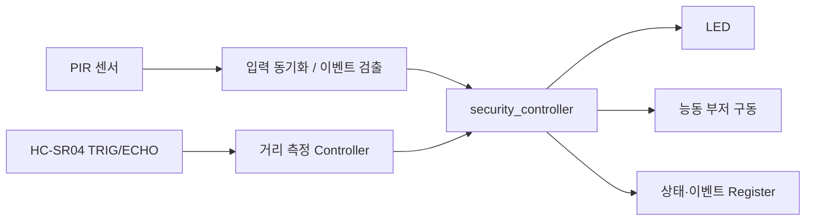

# CAPSTONE-01 — PIR 침입 감지와 거리 연동 보안 제어

[주변장치 홈](../README.md) · [운영 하네스](../../HARNESS.md) · [RTL 29 센서 통합 경보](../../rtl/rtl29_integration/README.md) · [RTL 32 캡스톤 제어](../../rtl/rtl32_capstone_control/README.md)

**분류:** GPIO 입력 + 초음파 펄스 입력 → LED/부저 경보 + 상태 레지스터 (확장안)

**검증 상태 (2026-11-02):** 공개 튜토리얼의 프로젝트·부품·연결도·예제코드 존재 확인. **우리의 통합 RTL/C/실물 보드 구현 및 검증은 아직 실시하지 않음.**

## 1. 출처가 확인된 원본 사례

- 프로젝트: **Keyestudio KS5003/KS5004 ESP32 42-in-1 Sensor Kit — Project 47: Intrusion Detection**.
- 원본 튜토리얼: [Python Tutorial(Windows), Project 47](https://github.com/keyestudio/KS5003-KS5004-Keyestudio-ESP32-42-in-1-Sensor-Kit/blob/master/docs/2.Python_Tutorial%28Windows%29/Python_Tutorial%28Windows%29.md)
- 저장소: [제조사 GitHub](https://github.com/keyestudio/KS5003-KS5004-Keyestudio-ESP32-42-in-1-Sensor-Kit)
- 조회 기준 커밋: [`4adb6ce17ee454d10230b03030d5818e27cc0278`](https://github.com/keyestudio/KS5003-KS5004-Keyestudio-ESP32-42-in-1-Sensor-Kit/tree/4adb6ce17ee454d10230b03030d5818e27cc0278) (2026-11-02 조회).
- **실제 원본 구성:** ESP32 보드, 확장 보드, PIR 모듈, 능동 부저, LED, 케이블. **Connection Diagram(배선도)**, 테스트 코드, 결과 설명이 함께 있다. 모듈 내부 회로도 전체 제공 여부는 별도 확인이 필요하다.
- **원본 동작:** PIR 움직임 감지 시 LED/부저가 약 0.2초 간격으로 점멸·경보하고, 미감지 시 꺼진다. 콘솔에는 침입 경고를 표시한다. 원본 예제의 GPIO 번호(ESP32 Pin 15/22/4)는 **Basys3 물리핀 번호가 아니다.**
- **라이선스:** 2026-11-02 기준 원본 저장소 메타데이터의 `license`는 `null`이며 루트 `LICENSE`, `LICENSE.md`, `LICENSE.txt`를 찾지 못했다. **공개 저장소라는 이유만으로 복제·재배포 권한이 생기지 않는다.** 사진·코드·배선도를 직접 재게시하지 않고 원문 링크로 제공한다.

## 2. 우리 실습용 확장 (원본 프로젝트와 구분)

| 항목 | Keyestudio Project 47 원본 | Basys3/SoC 확장 설계안 |
|---|---|---|
| 움직임 입력 | PIR 센서 | PIR 센서 → 입력 동기화/이벤트 검출 |
| 거리 입력 | 없음 | **HC-SR04 추가**: TRIG 생성/ECHO 펄스 측정 |
| 출력 | LED + 능동 부저 | 보드 LED + 안전하게 구동한 외부 부저 |
| 제어 | ESP32 Python 분기/지연 | 별도 `security_controller` FSM, 이벤트 래치, 시간 제어 |
| 기록 | 콘솔 경고 | 이벤트·거리·상태 레지스터, 필요 시 UART |
| SoC | 없음 | **A안**: AXI GPIO로 PIR/LED를 읽고 제어하는 기초 경로. **B안**: 별도 검증한 AXI4-Lite 슬레이브로 이벤트·거리 레지스터 노출 (미구현) |

**의도된 흐름(제안):** PIR 입력 동기화/상승 이벤트 → HC-SR04 주기 측정 결과의 **새 샘플 발생 시점** 확인 → 거리 정상/타임아웃 분기 → 이벤트 래치 → LED/부저 경보. 기존 `ultrasonic_distance_meter`는 `enable`로 **주기 측정**하는 엔진이며 PIR마다 측정을 시작하는 `start_pulse` 입력이 없다. PIR 직후 강제 측정을 구현했다고 표현하지 않는다. `distance_valid`는 레벨 상태로 유지될 수 있으므로 **1회 샘플 이벤트와 혼용 금지**. PIR만 경보할지 거리 조건을 병용할지는 별도 제어정책으로 확정해야 한다.

**하드웨어 분할:** Top Module에는 포트 선언·wire·인스턴스·핀 연결만 둔다. 실제 상태 판단, 타이머, 거리/이벤트 제어는 Controller/IP로 분리한다. `security_controller`는 **제안 명칭**이며 현재 저장소에 구현됐다고 주장하지 않는다.

### 2.1 실제 소스와 제안 모듈의 경계

| 명칭 | 저장소에 있는 기능 | 캡스톤에 필요한 추가 작업 |
|---|---|---|
| [`pir_event.v`](../../rtl/rtl10_pir_event/src/pir_event.v) | `pir_in` 동기화 → `motion`, `rose`, `fall` | PIR 실제 출력 전압·예열 확인, Controller 연결 |
| [`ultrasonic_distance_meter.v`](../gpio/rtl/ultrasonic_distance_meter.v) | `echo` → `trig`, `distance_cm[9:0]`, `distance_valid`, `busy`, `timeout_error` | ECHO 레벨 변환, 신규 샘플 스트로브 정의·검증 |
| [`ultrasonic_alarm.v`](../../rtl/rtl11_ultrasonic_event/src/ultrasonic_alarm.v) | 16비트 `distance_cm`·`distance_valid` 기반 거리 임계 경보 | 10→16비트 영확장, `distance_valid` 레벨/펄스 의미 대조 |
| [`status_registers.v`](../../rtl/rtl31_register_map/src/status_registers.v) | 간단한 2주소 레지스터 실습 | **AXI4-Lite 슬레이브가 아님**, 아래 제안 맵과 동일하지 않음 |
| [`capstone_controller.v`](../../rtl/rtl32_capstone_control/src/capstone_controller.v) | **온도·거리 입력으로 모터/LED 제어** | PIR·HC-SR04 보안 Controller가 아니며 **그대로 결합 불가** |
| `security_controller`, `security_regs` | **제안 명칭, 파일 없음** | 이벤트 래치·경보정책·레지스터 구현·독립 테스트벤치 필요 |

`rtl29_integration`도 온도·거리 경보 예제이지 PIR·거리 보안 통합 구현은 아니다. **기존 32과제 소스는 변경하지 않고 재사용 후보로만 취급**한다.

### 2.2 제안 레지스터 맵 (새 설계, 미구현)

32비트 데이터·4바이트 정렬 주소 기준의 **교육용 초안**이다. 아래 주소는 기존 `us_axil_regs.v`나 `status_registers.v`의 실제 주소가 아니며 Vivado Address Editor의 베이스 주소도 아직 배정되지 않았다.

| 오프셋 | 이름 | 접근 | 제안 비트와 의미 |
|---|---|---|---|
| `0x00` | CTRL | RW | [0] enable, [1] arm, [2] alarm_latch_enable |
| `0x04` | STATUS | RO | [0] pir_motion, [1] alarm, [2] last_distance_valid, [3] last_timeout, [4] busy, [5] armed |
| `0x08` | DISTANCE_CM | RO | [9:0] 마지막 정상 거리(cm). **last_distance_valid=0이면 사용 금지** |
| `0x0C` | EVENT_PENDING | RW1C | [0] pir_rise, [1] near_distance, [2] echo_timeout; 해당 비트에 1을 쓰면 지움 |
| `0x10` | THRESHOLD_CM | RW | [9:0] 거리 경보 임계값, 초기 제안 20 cm |
| `0x14` | IRQ_ENABLE | RW | [2:0] EVENT_PENDING 비트별 인터럽트 허용 |

- 이벤트는 **Set 우선**: 하드웨어 이벤트 발생과 W1C 쓰기가 같은 클럭에 겹치면 새 이벤트를 보존한다. Reset은 이벤트/IRQ/경보를 초기화한다.
- 정상 샘플에만 DISTANCE_CM을 갱신하고, 타임아웃에는 `last_distance_valid`를 내린다. **오래된 거리값을 현재 측정으로 취급하지 않는다.**
- `THRESHOLD_CM`의 범위·0값 처리, PIR 경보 단독/거리 결합 조건, 이벤트 발생시각·IRQ 연결은 구현 전에 정책을 확정한다.
- `us_axil_top.v`·`us_axil_regs.v`에는 **WSTRB 누락 및 AW/W 동시 수락 문제(P1)**가 기록되어 있다. [기존 RTL 감사](../gpio/rtl/README.md)의 미해결 항목을 통과하기 전 완전한 AXI4-Lite IP로 간주하지 않는다.

### 2.3 SoC 연결은 두 경로로 분리

- **A안(기초)**: MicroBlaze V → 기존 AMD AXI GPIO → PIR 입력·LED 출력. 소프트웨어에서 이벤트를 관리하며 초음파 타이밍 엔진과 하드웨어 이벤트 레지스터가 **완성됐다는 뜻이 아니다**.
- **B안(확장)**: `pir_event` + `ultrasonic_distance_meter` + 신규 `security_controller` + 신규 `security_regs` → 검증된 AXI4-Lite 래퍼 → MicroBlaze V의 메모리 매핑 접근. `status_registers.v`만으로 B안의 버스 연결을 대체할 수 없다.

**구현 게이트:** P0 전압·부저 구동 확인 → 독립 RTL 기능 TB → 통합 기능 TB → AXI AW/W 분리·WSTRB·BREADY/AR/RREADY·Reset 검증 → Vivado 합성/Timing → 보드 실측. 미통과 단계는 공개 문서에서 완료로 표시하지 않는다.

## 3. 자료 연결(기존 코드 보존)

| 기능 | 기존 참조 |
|---|---|
| PIR 모듈 정보 | [HC-SR501](../gpio/hc-sr501.md) |
| HC-SR04 정보·안전 | [HC-SR04](../gpio/hc-sr04.md) |
| GPIO RTL 실습 | [RTL10 PIR 이벤트](../../rtl/rtl10_pir_event/README.md) |
| 초음파 이벤트 RTL | [RTL11 초음파](../../rtl/rtl11_ultrasonic_event/README.md) |
| 경보 통합 참고 | [RTL29 센서 통합](../../rtl/rtl29_integration/README.md) |
| 레지스터 맵 | [RTL31 Register Map](../../rtl/rtl31_register_map/README.md) |
| 캡스톤 제어 | [RTL32](../../rtl/rtl32_capstone_control/README.md) |

이 자료들은 **재사용 후보/소스 작성 상태**를 나타낸다. 실제로 연결·합성·보드 검증이 끝났다는 뜻이 아니다.

## 4. 전기적 설계 검증 (실물 연결 전 필수)

1. **PIR 모듈:** 실제 구입한 HC-SR501 등 보드의 전원 조건·출력 HIGH 전압·예열시간을 모듈별 확인한다. 제품 모델이 다르면 데이터시트/기판 정보 재검증.
2. **HC-SR04:** 일반 5V 구동품의 ECHO는 5V가 될 수 있으므로 Basys3 3.3V GPIO에 직접 연결하지 않는다. 계산된 저항분압 또는 적절한 레벨 변환 회로를 확인한다. 10µs TRIG 및 ECHO 폭 측정은 사용 모듈 데이터시트로 확정한다.
3. **부저:** 능동형/수동형을 구분하고 소비전류를 확인한다. 보드 핀의 구동 한도를 넘는 경우 트랜지스터 드라이버와 적절한 전원을 사용한다.
4. **접지·전원:** 전원 구성, 공통 GND, 외부 5V의 역류 및 오배선을 실측 후 승인한다. 회로도/배선도에 사용 모델의 실제 핀 이름을 적는다.

## 5. 단계별 구현·테스트

| 단계 | 내용 | 검증 기준 |
|---|---|---|
| C1 | 원본 사례 문서/배선도/소스 확인 | URL·커밋·부품명이 일치 |
| C2 | PIR 하나 → LED 하나 | 입력 동기화·LED 반응 (RTL Simulation 이후 보드 확인) |
| C3 | HC-SR04 → 거리값 | ECHO 타임아웃/미검출/정상 폭 독립 시험 |
| C4 | PIR + 거리 → LED/부저 | 2개 입력 + 2개 출력의 경보 시나리오 |
| C5 | 이벤트·상태 Register | Clear/Set 우선순위, 읽기·쓰기·Reset 테스트 |
| C6 | MicroBlaze V SoC 응용 | A안 AXI GPIO 기초 실습 → B안 사용자 AXI4-Lite 버스 검증 후 주소맵/드라이버/실기 시험 |

Testbench 시나리오: Reset → PIR=0 → PIR 검출 → ECHO 정상/타임아웃 → 경보 래치 → 해제 → 재검출. Clock 단위 기대값을 정의한 뒤 self-checking TB를 수행한다.

## 6. 프로젝트 문서 배포 형태

1. 원본 사례 요약(링크)·기술적으로 확인한 사실과 자체 확장안 구분.
2. 센서/출력 부품표, I/O 핀/전압·레벨 변환 회로, 블록도.
3. Arduino 원본 실습 ↔ Basys3 RTL ↔ MicroBlaze V SoC 비교.
4. 실제 사용한 RTL·TB·드라이버와 실행 명령/화면 (검증된 것만).
5. 회로 오류 점검, 테스트 결과, 미확인 내용, 출처/라이선스.

> **현재는 출처 조사 + 설계안 문서화 단계입니다.** 실제 구현과 실습 결과는 미확인입니다.
