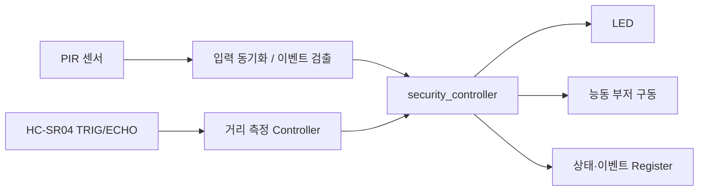

# CAPSTONE-01 — PIR 침입 감지와 거리 연동 보안 제어

[주변장치 홈](../README.md) · [운영 하네스](../../HARNESS.md) · [RTL 29 센서 통합 경보](../../rtl/rtl29_integration/README.md) · [RTL 32 캡스톤 제어](../../rtl/rtl32_capstone_control/README.md)

**분류:** GPIO 입력 + 초음파 펄스 입력 → LED/부저 경보 + 상태 레지스터 (확장안)

**검증 상태 (2026-11-02):** 공개 튜토리얼의 프로젝트·부품·연결도·예제코드 존재 확인. **우리의 통합 RTL/C/실물 보드 구현 및 검증은 아직 실시하지 않음.**

## 1. 출처가 확인된 원본 사례

- 프로젝트: **Keyestudio KS5003/KS5004 ESP32 42-in-1 Sensor Kit — Project 47: Intrusion Detection**.
- 원본 튜토리얼: [Python Tutorial(Windows), Project 47](https://github.com/keyestudio/KS5003-KS5004-Keyestudio-ESP32-42-in-1-Sensor-Kit/blob/master/docs/2.Python_Tutorial%28Windows%29/Python_Tutorial%28Windows%29.md)
- 저장소: [제조사 GitHub](https://github.com/keyestudio/KS5003-KS5004-Keyestudio-ESP32-42-in-1-Sensor-Kit)
- 조회 기준 커밋: [`4adb6ce17ee454d10230b03030d5818e27cc0278`](https://github.com/keyestudio/KS5003-KS5004-Keyestudio-ESP32-42-in-1-Sensor-Kit/tree/4adb6ce17ee454d10230b03030d5818e27cc0278) (2026-11-02 조회).
- **실제 원본 구성:** ESP32 보드, 확장 보드, PIR 모듈, 능동 부저, LED, 케이블. **Connection Diagram(배선도)**, 테스트 코드, 결과 설명이 함께 있다. 모듈 내부 회로도 전체 제공 여부는 별도 확인이 필요하다.
- **원본 동작:** PIR 움직임 감지 시 LED/부저가 약 0.2초 간격으로 점멸·경보하고, 미감지 시 꺼진다. 콘솔에는 침입 경고를 표시한다. 원본 예제의 GPIO 번호(ESP32 Pin 15/22/4)는 **Basys3 물리핀 번호가 아니다.**
- **라이선스:** 해당 GitHub 자료의 사용·재배포 라이선스 별도 확인 전. 사진·코드·회로도는 무단 복사해 재게시하지 않고 링크로 제공한다.

## 2. 우리 실습용 확장 (원본 프로젝트와 구분)

| 항목 | Keyestudio Project 47 원본 | Basys3/SoC 확장 설계안 |
|---|---|---|
| 움직임 입력 | PIR 센서 | PIR 센서 → 입력 동기화/이벤트 검출 |
| 거리 입력 | 없음 | **HC-SR04 추가**: TRIG 생성/ECHO 펄스 측정 |
| 출력 | LED + 능동 부저 | 보드 LED + 안전하게 구동한 외부 부저 |
| 제어 | ESP32 Python 분기/지연 | 별도 `security_controller` FSM, 이벤트 래치, 시간 제어 |
| 기록 | 콘솔 경고 | 이벤트·거리·상태 레지스터, 필요 시 UART |
| SoC | 없음 | 기존 AMD AXI GPIO/Timer/선택 UART IP 경유 C 드라이버 |

**의도된 흐름:** PIR 감지 → 거리 샘플 요청 → 거리 측정(성공/타임아웃) → 이벤트 레지스터 갱신 → 경보 출력. PIR만으로 경보할지, 거리 조건을 병용할지는 제어정책을 정한 후 검증한다.

**하드웨어 분할:** Top Module에는 포트 선언·wire·인스턴스·핀 연결만 둔다. 실제 상태 판단, 타이머, 거리/이벤트 제어는 Controller/IP로 분리한다. `security_controller`는 **제안 명칭**이며 현재 저장소에 구현됐다고 주장하지 않는다.

## 3. 자료 연결(기존 코드 보존)

| 기능 | 기존 참조 |
|---|---|
| PIR 모듈 정보 | [HC-SR501](../gpio/hc-sr501.md) |
| HC-SR04 정보·안전 | [HC-SR04](../gpio/hc-sr04.md) |
| GPIO RTL 실습 | [RTL10 PIR 이벤트](../../rtl/rtl10_pir_event/README.md) |
| 초음파 이벤트 RTL | [RTL11 초음파](../../rtl/rtl11_ultrasonic_event/README.md) |
| 경보 통합 참고 | [RTL29 센서 통합](../../rtl/rtl29_integration/README.md) |
| 레지스터 맵 | [RTL31 Register Map](../../rtl/rtl31_register_map/README.md) |
| 캡스톤 제어 | [RTL32](../../rtl/rtl32_capstone_control/README.md) |

이 자료들은 **재사용 후보/소스 작성 상태**를 나타낸다. 실제로 연결·합성·보드 검증이 끝났다는 뜻이 아니다.

## 4. 전기적 설계 검증 (실물 연결 전 필수)

1. **PIR 모듈:** 실제 구입한 HC-SR501 등 보드의 전원 조건·출력 HIGH 전압·예열시간을 모듈별 확인한다. 제품 모델이 다르면 데이터시트/기판 정보 재검증.
2. **HC-SR04:** 일반 5V 구동품의 ECHO는 5V가 될 수 있으므로 Basys3 3.3V GPIO에 직접 연결하지 않는다. 계산된 저항분압 또는 적절한 레벨 변환 회로를 확인한다. 10µs TRIG 및 ECHO 폭 측정은 사용 모듈 데이터시트로 확정한다.
3. **부저:** 능동형/수동형을 구분하고 소비전류를 확인한다. 보드 핀의 구동 한도를 넘는 경우 트랜지스터 드라이버와 적절한 전원을 사용한다.
4. **접지·전원:** 전원 구성, 공통 GND, 외부 5V의 역류 및 오배선을 실측 후 승인한다. 회로도/배선도에 사용 모델의 실제 핀 이름을 적는다.

## 5. 단계별 구현·테스트

| 단계 | 내용 | 검증 기준 |
|---|---|---|
| C1 | 원본 사례 문서/배선도/소스 확인 | URL·커밋·부품명이 일치 |
| C2 | PIR 하나 → LED 하나 | 입력 동기화·LED 반응 (RTL Simulation 이후 보드 확인) |
| C3 | HC-SR04 → 거리값 | ECHO 타임아웃/미검출/정상 폭 독립 시험 |
| C4 | PIR + 거리 → LED/부저 | 2개 입력 + 2개 출력의 경보 시나리오 |
| C5 | 이벤트·상태 Register | Clear/Set 우선순위, 읽기·쓰기·Reset 테스트 |
| C6 | MicroBlaze V SoC 응용 | 기존 AXI IP 연결/주소맵/드라이버/실기 시험 |

Testbench 시나리오: Reset → PIR=0 → PIR 검출 → ECHO 정상/타임아웃 → 경보 래치 → 해제 → 재검출. Clock 단위 기대값을 정의한 뒤 self-checking TB를 수행한다.

## 6. 프로젝트 문서 배포 형태

1. 원본 사례 요약(링크)·기술적으로 확인한 사실과 자체 확장안 구분.
2. 센서/출력 부품표, I/O 핀/전압·레벨 변환 회로, 블록도.
3. Arduino 원본 실습 ↔ Basys3 RTL ↔ MicroBlaze V SoC 비교.
4. 실제 사용한 RTL·TB·드라이버와 실행 명령/화면 (검증된 것만).
5. 회로 오류 점검, 테스트 결과, 미확인 내용, 출처/라이선스.

> **현재는 출처 조사 + 설계안 문서화 단계입니다.** 실제 구현과 실습 결과는 미확인입니다.
