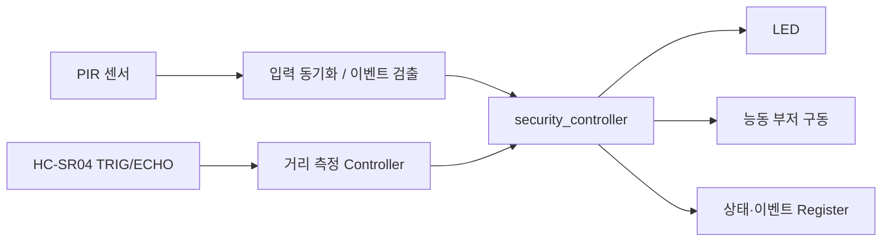

# CAPSTONE-01 — PIR 침입 감지와 거리 연동 보안 제어

## 캡스톤 목록

| 번호 | 주제 | 문서 | 독립 HTML | 구현 상태 |
|---|---|---|---|---|
| 01 | PIR 침입 감지·거리 연동 보안 제어 | [설계서](README.md) | [HTML](index.html) | 기존 소스 연계·통합 미검증 |
| 02 | CAPSTONE-02 — 버튼 기반 SG90 위치 서보 제어·상태 표시 | [설계서](capstone-02-sg90-position.md) | [HTML](capstone-02-sg90-position.html) | 설계안·통합 미구현 |
| 03 | CAPSTONE-03 — 로터리 엔코더 회전 카운터와 Basys3 LED 상태판 | [설계서](capstone-03-encoder-led-counter.md) | [HTML](capstone-03-encoder-led-counter.html) | 설계안·통합 미구현 |
| 04 | CAPSTONE-04 — 차량 접근형 스마트 주차장 차단기 | [설계서](capstone-04-smart-parking-gate.md) | [HTML](capstone-04-smart-parking-gate.html) | 설계안·통합 미구현 |
| 05 | CAPSTONE-05 — 터치·버튼 이중 입력 반응시간 측정기 | [설계서](capstone-05-touch-reaction-timer.md) | [HTML](capstone-05-touch-reaction-timer.html) | 설계안·통합 미구현 |
| 06 | CAPSTONE-06 — 움직임·조도 융합 야간 복도 조명 | [설계서](capstone-06-night-hallway.md) | [HTML](capstone-06-night-hallway.html) | 설계안·통합 미구현 |
| 07 | CAPSTONE-07 — 출입 움직임·터치 확인 창고 경보 | [설계서](capstone-07-warehouse-door.md) | [HTML](capstone-07-warehouse-door.html) | 설계안·통합 미구현 |
| 08 | CAPSTONE-08 — 온습도·엔코더 기반 쾌적 환기 | [설계서](capstone-08-fan-comfort.md) | [HTML](capstone-08-fan-comfort.html) | 설계안·통합 미구현 |
| 09 | CAPSTONE-09 — UART·터치 이중 승인 저전압 타이머 스위치 | [설계서](capstone-09-dual-consent-timed-switch.md) | [HTML](capstone-09-dual-consent-timed-switch.html) | 설계안·통합 미구현 |
| 10 | CAPSTONE-10 — UART 프레임 CRC-8 무결성 감시·오류 계수기 | [설계서](capstone-10-uart-crc-packet-monitor.md) | [HTML](capstone-10-uart-crc-packet-monitor.html) | 설계안·통합 미구현 |
| 11 | CAPSTONE-11 — 기계 회전수·온도 이상 경보 | [설계서](capstone-11-machine-guard.md) | [HTML](capstone-11-machine-guard.html) | 설계안·통합 미구현 |
| 12 | CAPSTONE-12 — I²C 버스 응답 지연·장애 감시기 | [설계서](capstone-12-i2c-bus-health-monitor.md) | [HTML](capstone-12-i2c-bus-health-monitor.html) | 설계안·통합 미구현 |
| 13 | CAPSTONE-13 — UART 하트비트 감시·안전 정지 상태기 | [설계서](capstone-13-uart-heartbeat-failsafe.md) | [HTML](capstone-13-uart-heartbeat-failsafe.html) | 설계안·통합 미구현 |
| 14 | CAPSTONE-14 — 터치 승인형 자동 분류 게이트 | [설계서](capstone-14-touch-sorter.md) | [HTML](capstone-14-touch-sorter.html) | 설계안·통합 미구현 |
| 15 | CAPSTONE-15 — UART 명령 속도 제한·과부하 차단기 | [설계서](capstone-15-uart-rate-limiter.md) | [HTML](capstone-15-uart-rate-limiter.html) | 설계안·통합 미구현 |
| 16 | CAPSTONE-16 — 수온 감시·경보 릴레이 제어 | [설계서](capstone-16-aquarium-temperature.md) | [HTML](capstone-16-aquarium-temperature.html) | 설계안·통합 미구현 |
| 17 | CAPSTONE-17 — 엔코더 기반 모터 걸림 감지 | [설계서](capstone-17-motor-jam-guard.md) | [HTML](capstone-17-motor-jam-guard.html) | 설계안·통합 미구현 |
| 18 | CAPSTONE-18 — 비상 통로 접근 감지 안내등 | [설계서](capstone-18-escape-route.md) | [HTML](capstone-18-escape-route.html) | 설계안·통합 미구현 |
| 19 | CAPSTONE-19 — 터치 모드·온도 연동 개인용 팬 | [설계서](capstone-19-touch-fan.md) | [HTML](capstone-19-touch-fan.html) | 설계안·통합 미구현 |
| 20 | CAPSTONE-20 — 움직임 감지형 서보 추적 거치대 | [설계서](capstone-20-motion-servo-camera.md) | [HTML](capstone-20-motion-servo-camera.html) | 설계안·통합 미구현 |
| 21 | CAPSTONE-21 — 온도·조도 복합 환경 알림 | [설계서](capstone-21-ambient-alert.md) | [HTML](capstone-21-ambient-alert.html) | 설계안·통합 미구현 |
| 22 | CAPSTONE-22 — HC-SR04 초음파·HC-SR501 PIR 융합 LED PWM 제어 (LED 오류 코드) | [설계서](capstone-22-fusion-00-01-00-00-00.md) | [HTML](capstone-22-fusion-00-01-00-00-00.html) | 설계안·통합 미구현 |
| 23 | CAPSTONE-23 — HC-SR04 초음파·DS18B20 온도 융합 능동 부저 제어 (UART 상태 보고) | [설계서](capstone-23-fusion-00-06-01-04-01.md) | [HTML](capstone-23-fusion-00-06-01-04-01.html) | 설계안·통합 미구현 |
| 24 | CAPSTONE-24 — HC-SR501 PIR·로터리 엔코더 융합 PWM 팬 제어 (AXI 상태 레지스터) | [설계서](capstone-24-fusion-01-04-03-00-02.md) | [HTML](capstone-24-fusion-01-04-03-00-02.html) | 설계안·통합 미구현 |
| 25 | CAPSTONE-25 — DHT22 온습도·HC-SR501 PIR 융합 TB6612FNG 모터 제어 (7세그먼트 상태) | [설계서](capstone-25-fusion-02-01-04-04-03.md) | [HTML](capstone-25-fusion-02-01-04-04-03.html) | 설계안·통합 미구현 |
| 26 | CAPSTONE-26 — BH1750 조도·HC-SR04 초음파 융합 LED PWM 제어 (LED 오류 코드) | [설계서](capstone-26-fusion-03-00-00-01-00.md) | [HTML](capstone-26-fusion-03-00-00-01-00.html) | 설계안·통합 미구현 |
| 27 | CAPSTONE-27 — BH1750 조도·DS18B20 온도 융합 능동 부저 제어 (UART 상태 보고) | [설계서](capstone-27-fusion-03-06-01-05-01.md) | [HTML](capstone-27-fusion-03-06-01-05-01.html) | 설계안·통합 미구현 |
| 28 | CAPSTONE-28 — 로터리 엔코더·BH1750 조도 융합 PWM 팬 제어 (AXI 상태 레지스터) | [설계서](capstone-28-fusion-04-03-03-01-02.md) | [HTML](capstone-28-fusion-04-03-03-01-02.html) | 설계안·통합 미구현 |
| 29 | CAPSTONE-29 — TTP223 터치·HC-SR501 PIR 융합 TB6612FNG 모터 제어 (7세그먼트 상태) | [설계서](capstone-29-fusion-05-01-04-05-03.md) | [HTML](capstone-29-fusion-05-01-04-05-03.html) | 설계안·통합 미구현 |
| 30 | CAPSTONE-30 — DS18B20 온도·HC-SR04 초음파 융합 LED PWM 제어 (LED 오류 코드) | [설계서](capstone-30-fusion-06-00-00-02-00.md) | [HTML](capstone-30-fusion-06-00-00-02-00.html) | 설계안·통합 미구현 |
| 31 | CAPSTONE-31 — DS18B20 온도·TTP223 터치 융합 능동 부저 제어 (UART 상태 보고) | [설계서](capstone-31-fusion-06-05-01-06-01.md) | [HTML](capstone-31-fusion-06-05-01-06-01.html) | 설계안·통합 미구현 |
| 32 | CAPSTONE-32 — 수동 승인 버튼·BH1750 조도 융합 PWM 팬 제어 (AXI 상태 레지스터) | [설계서](capstone-32-fusion-07-03-03-02-02.md) | [HTML](capstone-32-fusion-07-03-03-02-02.html) | 설계안·통합 미구현 |
| 33 | CAPSTONE-33 — HC-SR04 초음파·DHT22 온습도 융합 TB6612FNG 모터 제어 (7세그먼트 상태) | [설계서](capstone-33-fusion-00-02-04-06-03.md) | [HTML](capstone-33-fusion-00-02-04-06-03.html) | 설계안·통합 미구현 |
| 34 | CAPSTONE-34 — HC-SR501 PIR·HC-SR04 초음파 융합 LED PWM 제어 (LED 오류 코드) | [설계서](capstone-34-fusion-01-00-00-03-00.md) | [HTML](capstone-34-fusion-01-00-00-03-00.html) | 설계안·통합 미구현 |
| 35 | CAPSTONE-35 — HC-SR501 PIR·DS18B20 온도 융합 능동 부저 제어 (UART 상태 보고) | [설계서](capstone-35-fusion-01-06-01-07-01.md) | [HTML](capstone-35-fusion-01-06-01-07-01.html) | 설계안·통합 미구현 |
| 36 | CAPSTONE-36 — DHT22 온습도·로터리 엔코더 융합 PWM 팬 제어 (AXI 상태 레지스터) | [설계서](capstone-36-fusion-02-04-03-03-02.md) | [HTML](capstone-36-fusion-02-04-03-03-02.html) | 설계안·통합 미구현 |
| 37 | CAPSTONE-37 — BH1750 조도·HC-SR501 PIR 융합 TB6612FNG 모터 제어 (7세그먼트 상태) | [설계서](capstone-37-fusion-03-01-04-07-03.md) | [HTML](capstone-37-fusion-03-01-04-07-03.html) | 설계안·통합 미구현 |
| 38 | CAPSTONE-38 — 로터리 엔코더·HC-SR04 초음파 융합 LED PWM 제어 (LED 오류 코드) | [설계서](capstone-38-fusion-04-00-00-04-00.md) | [HTML](capstone-38-fusion-04-00-00-04-00.html) | 설계안·통합 미구현 |
| 39 | CAPSTONE-39 — 로터리 엔코더·DS18B20 온도 융합 SG90 서보 제어 (UART 상태 보고) | [설계서](capstone-39-fusion-04-06-02-00-01.md) | [HTML](capstone-39-fusion-04-06-02-00-01.html) | 설계안·통합 미구현 |

[주변장치 홈](../README.md) · [운영 하네스](../../HARNESS.md) · [RTL 29 센서 통합 경보](../../rtl/rtl29_integration/README.md) · [RTL 32 캡스톤 제어](../../rtl/rtl32_capstone_control/README.md)

**분류:** GPIO 입력 + 초음파 펄스 입력 → LED/부저 경보 + 상태 레지스터 (확장안)

**검증 상태 (2026-11-03):** 원본 튜토리얼의 프로젝트·부품·배선도·예제코드 존재 확인. 기존 HC-SR04용 AXI4-Lite 레지스터는 **WSTRB·AW/W 분리 처리 수정 및 지정된 RTL 회귀 시뮬레이션 통과**(아래 실행 근거). **PIR·HC-SR04 통합 보안 RTL, 신규 이벤트 레지스터, MicroBlaze V 통합 및 실물 보드 시험은 미실시.**

## 1. 출처가 확인된 원본 사례

- 프로젝트: **Keyestudio KS5003/KS5004 ESP32 42-in-1 Sensor Kit — Project 47: Intrusion Detection**.
- 원본 튜토리얼: [Python Tutorial(Windows), Project 47](https://github.com/keyestudio/KS5003-KS5004-Keyestudio-ESP32-42-in-1-Sensor-Kit/blob/master/docs/2.Python_Tutorial%28Windows%29/Python_Tutorial%28Windows%29.md)
- 저장소: [제조사 GitHub](https://github.com/keyestudio/KS5003-KS5004-Keyestudio-ESP32-42-in-1-Sensor-Kit)
- 조회 기준 커밋: [`4adb6ce17ee454d10230b03030d5818e27cc0278`](https://github.com/keyestudio/KS5003-KS5004-Keyestudio-ESP32-42-in-1-Sensor-Kit/tree/4adb6ce17ee454d10230b03030d5818e27cc0278) (2026-11-02 조회).
- **실제 원본 구성:** ESP32 보드, 확장 보드, PIR 모듈, 능동 부저, LED, 케이블. **Connection Diagram(배선도)**, 테스트 코드, 결과 설명이 함께 있다. 모듈 내부 회로도 전체 제공 여부는 별도 확인이 필요하다.
- **원본 동작:** PIR 움직임 감지 시 LED/부저가 약 0.2초 간격으로 점멸·경보하고, 미감지 시 꺼진다. 콘솔에는 침입 경고를 표시한다. 원본 예제의 GPIO 번호(ESP32 Pin 15/22/4)는 **Basys3 물리핀 번호가 아니다.**
- **라이선스:** 2026-11-02 기준 원본 저장소 메타데이터의 `license`는 `null`이며 루트 `LICENSE`, `LICENSE.md`, `LICENSE.txt`를 찾지 못했다. **공개 저장소라는 이유만으로 복제·재배포 권한이 생기지 않는다.** 사진·코드·배선도를 직접 재게시하지 않고 원문 링크로 제공한다.

## 2. 우리 실습용 확장 (원본 프로젝트와 구분)

| 항목 | Keyestudio Project 47 원본 | Basys3/SoC 확장 설계안 |
|---|---|---|
| 움직임 입력 | PIR 센서 | PIR 센서 → 입력 동기화/이벤트 검출 |
| 거리 입력 | 없음 | **HC-SR04 추가**: TRIG 생성/ECHO 펄스 측정 |
| 출력 | LED + 능동 부저 | 보드 LED + 안전하게 구동한 외부 부저 |
| 제어 | ESP32 Python 분기/지연 | 별도 `security_controller` FSM, 이벤트 래치, 시간 제어 |
| 기록 | 콘솔 경고 | 이벤트·거리·상태 레지스터, 필요 시 UART |
| SoC | 없음 | **A안**: AXI GPIO로 PIR/LED를 읽고 제어하는 기초 경로. **B안**: 별도 검증한 AXI4-Lite 슬레이브로 이벤트·거리 레지스터 노출 (미구현) |

**의도된 흐름(제안):** PIR 입력 동기화/상승 이벤트 → HC-SR04 주기 측정 결과의 **새 샘플 발생 시점** 확인 → 거리 정상/타임아웃 분기 → 이벤트 래치 → LED/부저 경보. 기존 `ultrasonic_distance_meter`는 `enable`로 **주기 측정**하는 엔진이며 PIR마다 측정을 시작하는 `start_pulse` 입력이 없다. PIR 직후 강제 측정을 구현했다고 표현하지 않는다. `distance_valid`는 레벨 상태로 유지될 수 있으므로 **1회 샘플 이벤트와 혼용 금지**. PIR만 경보할지 거리 조건을 병용할지는 별도 제어정책으로 확정해야 한다.

**하드웨어 분할:** Top Module에는 포트 선언·wire·인스턴스·핀 연결만 둔다. 실제 상태 판단, 타이머, 거리/이벤트 제어는 Controller/IP로 분리한다. `security_controller`는 **제안 명칭**이며 현재 저장소에 구현됐다고 주장하지 않는다.

### 2.1 실제 소스와 제안 모듈의 경계

| 명칭 | 저장소에 있는 기능 | 캡스톤에 필요한 추가 작업 |
|---|---|---|
| [`pir_event.v`](../../rtl/rtl10_pir_event/src/pir_event.v) | `pir_in` 동기화 → `motion`, `rose`, `fall` | PIR 실제 출력 전압·예열 확인, Controller 연결 |
| [`ultrasonic_distance_meter.v`](../gpio/rtl/ultrasonic_distance_meter.v) | `echo` → `trig`, `distance_cm[9:0]`, `distance_valid`, `busy`, `timeout_error` | ECHO 레벨 변환, 신규 샘플 스트로브 정의·검증 |
| [`ultrasonic_alarm.v`](../../rtl/rtl11_ultrasonic_event/src/ultrasonic_alarm.v) | 16비트 `distance_cm`·`distance_valid` 기반 거리 임계 경보 | 10→16비트 영확장, `distance_valid` 레벨/펄스 의미 대조 |
| [`us_axil_top.v`](../gpio/rtl/us_axil_top.v) · [`us_axil_regs.v`](../gpio/rtl/us_axil_regs.v) | **기존 HC-SR04 전용** AXI4-Lite 레지스터(CTRL/STATUS/DIST/BCD/IRQ_EN) | WSTRB·AW/W 분리 수정, 지정된 TB 통과. **PIR/보안 이벤트 맵과는 별개** |
| [`status_registers.v`](../../rtl/rtl31_register_map/src/status_registers.v) | 간단한 2주소 레지스터 실습 | **AXI4-Lite 슬레이브가 아님**, 아래 제안 맵과 동일하지 않음 |
| [`capstone_controller.v`](../../rtl/rtl32_capstone_control/src/capstone_controller.v) | **온도·거리 입력으로 모터/LED 제어** | PIR·HC-SR04 보안 Controller가 아니며 **그대로 결합 불가** |
| `security_controller`, `security_regs` | **제안 명칭, 파일 없음** | 이벤트 래치·경보정책·레지스터 구현·독립 테스트벤치 필요 |

`rtl29_integration`도 온도·거리 경보 예제이지 PIR·거리 보안 통합 구현은 아니다. **기존 32과제 소스는 변경하지 않고 재사용 후보로만 취급**한다.

### 2.2 제안 레지스터 맵 (새 설계, 미구현)

32비트 데이터·4바이트 정렬 주소 기준의 **교육용 초안**이다. 아래 주소는 기존 `us_axil_regs.v`나 `status_registers.v`의 실제 주소가 아니며 Vivado Address Editor의 베이스 주소도 아직 배정되지 않았다.

| 오프셋 | 이름 | 접근 | 제안 비트와 의미 |
|---|---|---|---|
| `0x00` | CTRL | RW | [0] enable, [1] arm, [2] alarm_latch_enable |
| `0x04` | STATUS | RO | [0] pir_motion, [1] alarm, [2] last_distance_valid, [3] last_timeout, [4] busy, [5] armed |
| `0x08` | DISTANCE_CM | RO | [9:0] 마지막 정상 거리(cm). **last_distance_valid=0이면 사용 금지** |
| `0x0C` | EVENT_PENDING | RW1C | [0] pir_rise, [1] near_distance, [2] echo_timeout; 해당 비트에 1을 쓰면 지움 |
| `0x10` | THRESHOLD_CM | RW | [9:0] 거리 경보 임계값, 초기 제안 20 cm |
| `0x14` | IRQ_ENABLE | RW | [2:0] EVENT_PENDING 비트별 인터럽트 허용 |

- 이벤트는 **Set 우선**: 하드웨어 이벤트 발생과 W1C 쓰기가 같은 클럭에 겹치면 새 이벤트를 보존한다. Reset은 이벤트/IRQ/경보를 초기화한다.
- 정상 샘플에만 DISTANCE_CM을 갱신하고, 타임아웃에는 `last_distance_valid`를 내린다. **오래된 거리값을 현재 측정으로 취급하지 않는다.**
- `THRESHOLD_CM`의 범위·0값 처리, PIR 경보 단독/거리 결합 조건, 이벤트 발생시각·IRQ 연결은 구현 전에 정책을 확정한다.
- **2026-11-03 정정:** 기존 초음파용 `us_axil_top.v`·`us_axil_regs.v`의 **WSTRB 누락·AW/W 동시 수락 문제는 수정**되었고, AW 먼저/W 먼저/동시 수락, 부분 바이트, W1C, IRQ, B/R 백프레셔를 검사하는 [전용 테스트벤치](../gpio/tb/tb_us_axil_regs.v)가 [GitHub Actions #41480276825](https://github.com/Yuul-Jung/dev-board/actions/runs/41480276825)에서 통과했다. `us_axil_top`은 Icarus Verilog **컴파일**까지 확인했다. **AXI VIP, Vivado IP Integrator, 합성·Timing·보드 실측 및 보안용 신규 레지스터 맵 검증은 미실시**다. [최신 검증 기록](../VERIFICATION.md), [초음파 RTL 설명](../gpio/rtl/README.md) 참조.

### 2.3 SoC 연결은 두 경로로 분리

- **A안(기초)**: MicroBlaze V → 기존 AMD AXI GPIO → PIR 입력·LED 출력. 소프트웨어에서 이벤트를 관리하며 초음파 타이밍 엔진과 하드웨어 이벤트 레지스터가 **완성됐다는 뜻이 아니다**.
- **B안(확장)**: `pir_event` + `ultrasonic_distance_meter` + 신규 `security_controller` + 신규 `security_regs` → 검증된 AXI4-Lite 래퍼 → MicroBlaze V의 메모리 매핑 접근. `status_registers.v`만으로 B안의 버스 연결을 대체할 수 없다.

**구현 게이트:** P0 전압·부저 구동 확인 → PIR/거리 독립 RTL 기능 TB → **신규 보안 Controller 통합 TB** → **신규 보안 AXI 슬레이브** AW/W 분리·WSTRB·BREADY/AR/RREADY·Reset 검증 → Vivado 합성/Timing → 보드 실측. 기존 **초음파 전용** AXI 래퍼의 일부 지향성 시험 통과를 신규 보안 AXI 슬레이브의 검증으로 대체하지 않는다.

## 3. 자료 연결(기존 코드 보존)

| 기능 | 기존 참조 |
|---|---|
| PIR 모듈 정보 | [HC-SR501](../gpio/hc-sr501.md) |
| HC-SR04 정보·안전 | [HC-SR04](../gpio/hc-sr04.md) |
| GPIO RTL 실습 | [RTL10 PIR 이벤트](../../rtl/rtl10_pir_event/README.md) |
| 초음파 이벤트 RTL | [RTL11 초음파](../../rtl/rtl11_ultrasonic_event/README.md) |
| 경보 통합 참고 | [RTL29 센서 통합](../../rtl/rtl29_integration/README.md) |
| 레지스터 맵 | [RTL31 Register Map](../../rtl/rtl31_register_map/README.md) |
| 캡스톤 제어 | [RTL32](../../rtl/rtl32_capstone_control/README.md) |

이 자료들은 **재사용 후보/소스 작성 상태**를 나타낸다. 실제로 연결·합성·보드 검증이 끝났다는 뜻이 아니다.

## 4. 전기적 설계 검증 (실물 연결 전 필수)

1. **PIR 모듈:** 실제 구입한 HC-SR501 등 보드의 전원 조건·출력 HIGH 전압·예열시간을 모듈별 확인한다. 제품 모델이 다르면 데이터시트/기판 정보 재검증.
2. **HC-SR04:** 일반 5V 구동품의 ECHO는 5V가 될 수 있으므로 Basys3 3.3V GPIO에 직접 연결하지 않는다. 계산된 저항분압 또는 적절한 레벨 변환 회로를 확인한다. 10µs TRIG 및 ECHO 폭 측정은 사용 모듈 데이터시트로 확정한다.
3. **부저:** 능동형/수동형을 구분하고 소비전류를 확인한다. 보드 핀의 구동 한도를 넘는 경우 트랜지스터 드라이버와 적절한 전원을 사용한다.
4. **접지·전원:** 전원 구성, 공통 GND, 외부 5V의 역류 및 오배선을 실측 후 승인한다. 회로도/배선도에 사용 모델의 실제 핀 이름을 적는다.

## 5. 단계별 구현·테스트

| 단계 | 내용 | 검증 기준 |
|---|---|---|
| C1 | 원본 사례 문서/배선도/소스 확인 | URL·커밋·부품명이 일치 |
| C2 | PIR 하나 → LED 하나 | 입력 동기화·LED 반응 (RTL Simulation 이후 보드 확인) |
| C3 | HC-SR04 → 거리값 | ECHO 타임아웃/미검출/정상 폭 독립 시험 |
| C4 | PIR + 거리 → LED/부저 | 2개 입력 + 2개 출력의 경보 시나리오 |
| C5 | 이벤트·상태 Register | Clear/Set 우선순위, 읽기·쓰기·Reset 테스트 |
| C6 | MicroBlaze V SoC 응용 | A안 AXI GPIO 기초 실습 → B안 사용자 AXI4-Lite 버스 검증 후 주소맵/드라이버/실기 시험 |

Testbench 시나리오: Reset → PIR=0 → PIR 검출 → ECHO 정상/타임아웃 → 경보 래치 → 해제 → 재검출. Clock 단위 기대값을 정의한 뒤 self-checking TB를 수행한다.

## 6. 프로젝트 문서 배포 형태

1. 원본 사례 요약(링크)·기술적으로 확인한 사실과 자체 확장안 구분.
2. 센서/출력 부품표, I/O 핀/전압·레벨 변환 회로, 블록도.
3. Arduino 원본 실습 ↔ Basys3 RTL ↔ MicroBlaze V SoC 비교.
4. 실제 사용한 RTL·TB·드라이버와 실행 명령/화면 (검증된 것만).
5. 회로 오류 점검, 테스트 결과, 미확인 내용, 출처/라이선스.

> **현재는 출처 조사 + 설계안 문서화 단계입니다.** 실제 구현과 실습 결과는 미확인입니다.

## 7. 2026-11-03 갱신 근거 및 배포 게이트

| 검사 항목 | 실제 확인 결과 | 한계 |
|---|---|---|
| Keyestudio 원본 | [Project 47 원문](https://github.com/keyestudio/KS5003-KS5004-Keyestudio-ESP32-42-in-1-Sensor-Kit/blob/master/docs/2.Python_Tutorial%28Windows%29/Python_Tutorial%28Windows%29.md)의 PIR GPIO15, LED GPIO22, 능동 부저 GPIO4 및 0.2초 ON/OFF 분기 확인 | **ESP32 원본 배선도**이며 Basys3 배선도 아님. 저장소 LICENSE 파일·GitHub 라이선스 메타데이터 미확인 → 원본 사진/코드 복제 금지 |
| HC-SR04 변형 | [일반형 5 V](../gpio/hc-sr04.md)와 3.3 V 호환형·Grove 단선형·Arduino Modulino Distance(I²C ToF)를 구별 | 제품별 ECHO HIGH·풀업·핀 배열 실측 전 Basys3 연결 금지 |
| 기존 초음파 AXI4-Lite | [커밋 c56c4158](https://github.com/Yuul-Jung/dev-board/commit/c56c4158f299def310553c58ed45c767054996b4)에서 WSTRB·AW/W 분리 수정, [CI #41480276825](https://github.com/Yuul-Jung/dev-board/actions/runs/41480276825) **success** | **지정된 레지스터 TB와 Top 컴파일** 통과. AXI VIP/합성/실물·보안 통합은 미검증 |
| 문서·링크·호스트 시험 | 같은 CI의 Python/JSON·상대 링크·HTML 재생성 점검 및 C 호스트 모의시험 성공 | C 호스트 시험은 FPGA 실행 검증이 아님 |
| HTML 게시 | [Pages 배포 작업 #41480275045](https://github.com/Yuul-Jung/dev-board/actions/runs/41480275045) **success** | 실제 외부 브라우저 HTTP 접근 여부는 별도 확인 필요 |

**캡스톤 제안 회로·핀 배정 상태:** Basys3의 GPIO는 3.3 V 기준이고 일반 HC-SR04 ECHO는 5 V가 될 수 있다. 입력 보호·부저 드라이버·공통 접지·PIR 출력 HIGH 실측을 통과하지 않은 연결은 게시용 '검증 완료 회로'가 아니다. 초음파 엔진의 `distance_valid`는 유지 레벨이며, 신규 Controller는 완료 이벤트(예: 기존 AXI 레지스터의 W1C `done_flag` 또는 별도 단발 스트로브)를 **명시적으로 설계·검증**해야 한다.

## 8. 2026-11-03 최신 주변모듈 적대적 검증과 캡스톤 적용 범위

[최신 주변모듈 감사 커밋 `92504fa6`](https://github.com/Yuul-Jung/dev-board/commit/92504fa6d29ff381257ea0f7ad7835a1cde40d6b)과 [검증 기록](../VERIFICATION.md)을 대조했다. [GitHub Actions #41518731026](https://github.com/Yuul-Jung/dev-board/actions/runs/41518731026)은 해당 커밋의 문서·호스트·지정 RTL 검증 **success**로 기록되어 있다. 아래는 **이번 캡스톤 자체를 시험한 결과가 아니라, 기존 라이브러리에서 확인된 근거의 적용 범위**이다.

| 최신 자료·검증 | 확인된 범위 | CAPSTONE-01에 반영할 판단 |
|---|---|---|
| DHT22 단일선 모듈 변형 | 단품/Keyestudio/Grove의 전원·DATA 풀업·핀맵과 Modulino Thermo의 I²C를 구분 | **캡스톤 부품에 포함하지 않음.** 동일한 '센서'라는 이유로 PIR·HC-SR04 핀맵에 적용 금지 |
| KY-040/Keyestudio/Seeed 엔코더와 Modulino Knob | 직접 A/B GPIO와 STM32 경유 I²C를 구분 | **캡스톤 부품에 포함하지 않음.** 보드별 VCC/출력 HIGH 검증 원칙만 참고 |
| DHT22·Quad AXI4-Lite 수정 | 독립 AW/W 수락, WSTRB, W1C·IRQ·B/R 응답 지정 시험 통과 | 신규 보안 레지스터 설계 시 **검증 패턴을 참고**. 기존 시험 통과를 `security_regs` 검증으로 이전하지 않음 |
| 기존 HC-SR04 AXI4-Lite | [전용 TB](../gpio/tb/tb_us_axil_regs.v) 지정 시나리오 통과 | 거리 측정·기존 레지스터의 참고 구현. 신규 PIR 이벤트·경보 기능은 여전히 미구현 |

원본 [Keyestudio Project 47](https://github.com/keyestudio/KS5003-KS5004-Keyestudio-ESP32-42-in-1-Sensor-Kit/blob/master/docs/2.Python_Tutorial%28Windows%29/Python_Tutorial%28Windows%29.md)의 **ESP32 PIR GPIO15, LED GPIO22, 부저 GPIO4, 0.2초 ON/OFF 동작과 배선도**는 별도 원본 사실이다. 원본 저장소의 명시적 재배포 라이선스는 확인되지 않아 **원본 배선도·사진·코드는 링크로만 안내**한다. HC-SR04, 이벤트 레지스터, Basys3 RTL, MicroBlaze V AXI 연결은 자체 확장안이다.

### 8.1 기존 RTL의 실제 신호 계약과 신규 Controller 인계

| 기존 신호 | 소스에서 확인된 동작 | 신규 설계 시 금지할 오해 |
|---|---|---|
| `pir_event.rose` | 동기화된 PIR의 상승 변화 시 1클럭 펄스 | PIR 원본 ESP32 GPIO15를 Basys3 핀 번호로 사용 금지 |
| `ultrasonic_distance_meter.enable` | 1이면 주기 측정, 0이면 측정 중단·거리/valid 초기화 | PIR 이벤트마다 측정 시작하는 `start_pulse`로 취급 금지 |
| `distance_valid` | 정상 ECHO 종료 시 1로 설정, 이후 다음 실패·disable/reset 전까지 유지될 수 있음 | 매 측정마다 발생하는 단발 완료 펄스로 취급 금지 |
| `busy`, `timeout_error` | busy는 측정 구간 상태, timeout_error는 타임아웃 1클럭 펄스 | timeout 직후 이전 거리값을 새 거리로 사용 금지 |
| `us_axil_regs.done_flag` | `busy`의 하강을 검출한 시점에 `valid`가 1이면 W1C 이벤트 설정 | **기존 초음파 전용** 레지스터. PIR 이벤트 저장 기능 없음 |

신규 `security_controller`는 **정상 완료/타임아웃을 중복 없이 한 번씩 수용하는 규칙**을 정해야 한다. 기존 `done_flag`를 읽고 W1C로 지우는 방식은 SoC 소프트웨어 경로의 후보이며, RTL 내부에서 단발 스트로브를 새로 만드는 방식은 **구현·시험 전의 설계안**이다. 경보 정책(PIR 단독 또는 거리 조건 병용), timeout 후 fail-safe 경보, 임계값 0·범위 밖 처리, 경보 해제·재무장 규칙은 미확정이다.

### 8.2 신규 통합 테스트 승인표 (모두 미실시)

| 시나리오 | 기대 검증 항목 | 현재 |
|---|---|---|
| Reset/disable/재시작 | LED·부저·pending·IRQ 초기 상태와 거리 valid 무효화 | 미실시 |
| PIR 상승/유지/하강 | `rose` 1회 처리, 이벤트 중복 방지, debounce/예열 정책 | 미실시 |
| 거리 정상 샘플 연속 2회 | **새 샘플**만 처리, 오래된 `distance_valid` 재사용 방지 | 미실시 |
| ECHO 없음/지속 HIGH | timeout 1회 기록, 이전 거리값 무효화, 정책에 따른 경보 | 미실시 |
| EVENT_PENDING W1C와 새 이벤트 동시 | 하위 바이트 WSTRB, Set 우선, IRQ 유지/해제 | 미실시 |
| AXI AW 먼저/W 먼저/동시 및 B/R 대기 | 새 보안 AXI 슬레이브 독립 채널·응답 안정성 | 미실시 |
| 5 V ECHO·PIR HIGH·부저 전류 | 실제 모듈별 3.3 V GPIO 보호·레벨 변환·외부 구동 | 미실시 |
| Vivado 합성/Timing/보드 | 핀 XDC·전원·실측·MicroBlaze V 주소맵/C 접근 | 미실시 |

**배포 게이트:** 위 미실시 항목은 실험 결과로 게시하지 않는다. 기존 32차시 Arduino·RTL 소스, `devices/` 라이브러리 및 `amd_soc`는 변경하지 않는다.
