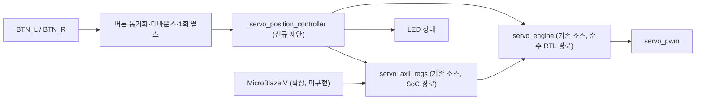

# CAPSTONE-02 — 버튼 기반 SG90 위치 서보 제어·상태 표시

[캡스톤 목록](README.md) · [HTML 독립 페이지](capstone-02-sg90-position.html) · [모듈 사양](../motor/sg90.md) · [최신 적대적 검증](../VERIFICATION.md)

**작성 기준:** 2026-11-03. **상태:** 신규 교육용 통합 **설계 문서**. 이 캡스톤의 버튼→서보 통합 RTL·SoC 드라이버·보드 시험은 **미구현·미실시**. 기존 서보 IP에 대한 지정 시뮬레이션 결과와 구별한다.

## 1. 목표와 부품

- 버튼 2개로 서보 명령 위치를 좌·우 단계 이동시키고, LED로 동작/오류 상태를 표시한다.
- SG90은 **위치형 아날로그** 모델만 대상으로 한다. SG90 360° 연속 회전형은 펄스가 속도·방향 명령이므로 제외한다.
- 입력: Basys3 BTN_L/BTN_R (보드 핀 이름은 XDC에서 실제 확인). 출력: LED, `servo_pwm` (3.3 V 논리 신호).
- 서보 VCC: 적절한 별도 4.8~5 V 공급, 충분한 전류 여유, FPGA와 **공통 GND**. Basys3 GPIO로 서보 전원을 공급하지 않는다.
- **3.3 V 신호 HIGH 인식은 미확인**. 실제 보유 서보의 입력 임계값과 필요 시 적절한 버퍼·레벨변환을 검증하기 전 연결 성공을 주장하지 않는다.

## 2. 공개 자료와 자체 설계의 경계

| 구분 | 근거/실제 내용 | 저작권·검증 |
|---|---|---|
| [TowerPro SG90 Analog](https://towerpro.com.tw/product/sg90-analog/) | 위치 제어형, 제조사 4.8 V 사양 | 제품 웹 페이지 재배포 라이선스 미확인, 그림·원문 미복제 |
| [TowerPro SG90 360°](https://towerpro.com.tw/product/sg90-360-degree-continuous-rotation-servo/) | 연속 회전형. 위치 제어형과 다름 | 제품 페이지 링크만 제공 |
| [Keyestudio KS0194](https://docs.keyestudio.com/projects/KS0194/en/latest/docs/KS0194.html) | 갈색 GND/빨강 VCC/주황 SIGNAL, 20 ms/500~2500 µs 교육 예시 | 튜토리얼 재배포 라이선스 미확인, 이미지·코드 미복제 |
| [Arduino Servo API](https://github.com/arduino-libraries/Servo/blob/440b319ec11ea2664df8ce201c271c935de28a2d/docs/api.md) | `attach()`, `writeMicroseconds()` 참고 | [LGPL-2.1](https://github.com/arduino-libraries/Servo/blob/440b319ec11ea2664df8ce201c271c935de28a2d/LICENSE.txt), 소스 복제 없음 |
| [Freenove Ultimate Starter Kit](https://github.com/Freenove/Freenove_Ultimate_Starter_Kit/tree/5315f61497eea49553aa1b70721751fb16a497e5) | 서보 실습 아이디어 참고 | [CC BY-NC-SA 3.0](https://github.com/Freenove/Freenove_Ultimate_Starter_Kit/blob/5315f61497eea49553aa1b70721751fb16a497e5/LICENSE.txt), 원본 미복제 |
| **CAPSTONE-02 자체 확장** | 버튼 2개 + 위치 상태 제어 + 서보 AXI4-Lite 레지스터 + LED 상태 + MicroBlaze V 선택 확장 | 신규 설계안, 통합 검증 전 |

## 3. 설계 구조

**주의:** 그림은 두 가지 **대체 제어 경로**를 함께 보여준다. 순수 RTL 경로는 `CTRL → ENG`, SoC 경로는 `MicroBlaze V → REG → ENG`이며, 같은 `servo_engine`에 두 컨트롤러를 동시에 구동시키지 않는다. 경로 선택은 별도 Wrapper 또는 검증된 MUX에서 수행한다. Top은 포트·wire·인스턴스 연결만 담당한다.

## 4. 제어 정책(제안, 아직 구현하지 않음)

| 조건 | 기대 동작 |
|---|---|
| Reset | 출력 PWM 비활성, 위치 명령 1500 µs로 초기화 |
| Enable 이후 | 20 ms 주기, 1500 µs 중심 명령으로 시작 |
| BTN_L 단발 | 현재 명령 폭에서 100 µs 감소, 하한 1000 µs |
| BTN_R 단발 | 현재 명령 폭에서 100 µs 증가, 상한 2000 µs |
| 두 버튼 동시 | 변경하지 않음(충돌 방지) |
| 버튼 계속 누름 | 디바운스 후 **1회만** 변경, 자동 반복 없음 |
| LED | ENABLE/동작 상태를 표시. 실제 각도 피드백이 아니므로 '위치 도달' 표시 금지 |

`PERIOD=20000 µs`, `MIN=1000 µs`, `MAX=2000 µs`, `WIDTH=1500 µs`는 교육용 보수적 **시작값**이다. 모든 SG90에 기계적 안전 범위로 보증된 값은 아니다. 기구부 간섭·정지 전류·소음이 있으면 즉시 전원을 끄고 범위를 좁힌다.

## 5. 재사용 가능한 실제 소스

| 파일 | 현재 구현 범위 | 통합 시 확인할 점 |
|---|---|---|
| [servo_engine.v](../motor/rtl/servo_engine.v) | 주기·펄스 폭 명령 생성, min/max clamp | `period_us=0`, `min_us>=period_us` 등 무효 직접 쓰기 차단 정책 필요 |
| [servo_axil_regs.v](../motor/rtl/servo_axil_regs.v) | CTRL/WIDTH/PERIOD/MIN/MAX/APPLIED AXI4-Lite 레지스터 | AW/W 독립 수락·WSTRB·백프레셔 지정 시험 결과 범위만 인정 |
| [servo_axil_top.v](../motor/rtl/servo_axil_top.v) | AXI 레지스터+엔진 연결 | AXI VIP·Vivado 합성·보드 검증은 별도 |
| [servo.c](../motor/sw/servo.c) | 호스트 검증 가능한 소프트웨어 제어 함수 | `servo_init()`의 유효 범위 검사를 우회하는 직접 MMIO 쓰기 금지 |
| [tb_servo_axil_regs.v](../motor/tb/tb_servo_axil_regs.v) | AXI 지정 시나리오 | 신규 버튼 Controller 통합 시험 아님 |

기존 RTL/Arduino 32차시 소스는 수정하지 않는다. 새 `servo_position_controller` 및 버튼 디바운스는 아직 파일로 구현되지 않았다.

## 6. 단계별 실습 및 승인 기준

| 단계 | 실습 | 검증 |
|---|---|---|
| S1 | 버튼 입력 2개 + LED 출력 1개 | 동기화/디바운스/동시입력/Reset 자체 TB |
| S2 | 서보 펄스 엔진 연결, LED 상태 추가 | 100 MHz 클록에서 20 ms 주기와 1000/1500/2000 µs 펄스 폭 시뮬레이션 |
| S3 | 전원·공통 GND·신호 레벨 확인 후 실물 서보 연결 | 외부 4.8~5 V 전원·전류·기구 간섭·3.3 V HIGH 인식 측정 |
| S4 | MicroBlaze V AXI4-Lite 경로 선택 구현 | CTRL/WIDTH/PERIOD/MIN/MAX/APPLIED 주소·WSTRB·B/R 핸드셰이크·드라이버 시험 |
| S5 | 보드 XDC·합성·Timing·실물 검증 | 전압/전류·동작 영상·로그·툴 버전·SHA 기록 |

**검증 근거:** [2026-11-03 SG90 적대적 검증](../VERIFICATION.md)에서 서보 AXI의 AW/W 독립 수락, WSTRB, B/R 응답 및 지정 시뮬레이션을 보고한다. [GitHub Actions #41551779497](https://github.com/Yuul-Jung/dev-board/actions/runs/41551779497)은 PR 브랜치 검증 기록이다. 이 캡스톤의 통합 RTL 시험과 실물 구동은 **미실시**다.

## 7. 미완료·위험

1. `servo_position_controller`·버튼 디바운스·상태 LED 통합 RTL 및 자체 TB 미작성.
2. 서보 AXI 직접 레지스터 쓰기로 무효 PERIOD/MIN/MAX를 설정할 수 있는 문제의 하드웨어 차단 정책 미확정.
3. 보유 SG90 실제 모델/3.3 V HIGH 인식/전원 용량·전류/물리적 각도 미확인.
4. AXI VIP, Vivado 합성·Timing, Basys3 실물 시험 및 MicroBlaze V 소프트웨어 통합 미실시.
