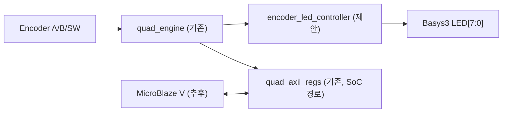

# CAPSTONE-03 — 로터리 엔코더 회전 카운터와 Basys3 LED 상태판

[캡스톤 목록](README.md) · [독립 HTML](capstone-03-encoder-led-counter.html) · [엔코더 자료](../gpio/rotary-encoder.md) · [최신 적대적 검증](../VERIFICATION.md)

**작성일:** 2026-11-03. **상태:** 자체 설계 캡스톤 문서. 기존 엔코더 RTL·AXI 레지스터는 저장소에 존재하지만, **이번 과제의 LED 표시 통합 RTL·보드 동작은 미구현·미검증**.

## 1. 과제와 안전 범위

- 범용 KY-040 계열 A/B 직교 엔코더를 돌려 **부호 있는 회전 카운트**를 누적하고, Basys3 내장 LED에 하위 8비트의 이진 값을 표시한다.
- 엔코더 버튼은 카운트 초기화 요청으로 사용한다. LED는 하위 비트의 **표시**일 뿐 전체 카운트나 절대 각도를 의미하지 않는다.
- 실습 순서: ① 입력 A/B+LED 표시 ② 버튼+이벤트 표시 ③ MicroBlaze V에서 AXI 레지스터 읽기/초기화.
- **전기적 P0:** 5 V 풀업이 연결된 KY-040·Keyestudio KS0013·Seeed Grove Encoder 신호를 Basys3 3.3 V 입력에 직결하지 않는다. 실제 모듈의 전원, 풀업, A/B/SW HIGH를 확인한 후 3.3 V 호환품 또는 적절한 레벨 변환을 사용한다. 접점의 정격 전압과 FPGA 입력 허용 전압은 다르다.

## 2. 출처 및 라이선스 경계

| 구분 | 확인된 사실 | 이용 조건·한계 |
|---|---|---|
| [Keyestudio KS0013](https://docs.keyestudio.com/projects/KS0013/en/latest/docs/KS0013.html) | 5 V 전원 사용의 디지털 로터리 엔코더 튜토리얼 | 원본 코드·그림 재배포 라이선스 미확인. 링크만 사용 |
| [Seeed Grove Encoder](https://wiki.seeedstudio.com/Grove-Encoder/) | Grove 엔코더의 4.5~5.5 V 전원 사양 | 동일 A/B GPIO 기판이라고 가정하지 않음. 원본 미복제 |
| [Arduino Modulino Knob](https://docs.arduino.cc/tutorials/modulino-knob/how-knob/) | STM32C011F4 기반 I²C/Qwiic 장치, 3.3 V | GPIO 직접 연결 KY-040과 프로토콜 다름 |
| [저장소 엔코더 자료](../gpio/rotary-encoder.md) | 기판 변형·풀업·출력 전압 관련 2026-11-03 적대적 검증 | 실제 구매품의 기판 변형은 미확인 |
| **CAPSTONE-03 자체 설계** | 엔코더 카운터 → LED 상태판 → MicroBlaze V AXI 확장 | 신규 통합 설계안, 원본 예제 복제 없음 |

## 3. 기존 소스와 신규 설계 구분

| 모듈 | 실제 소스/역할 | 이 캡스톤에서 필요한 일 |
|---|---|---|
| [quad_engine.v](../gpio/rtl/quad_engine.v) | A/B 직교 해석, 카운트, 버튼 이벤트 | 정확한 count/step_pulse/clear 타이밍 TB 재검증 |
| [quad_axil_regs.v](../gpio/rtl/quad_axil_regs.v) | 0x00 COUNT, 0x04 STATUS, 0x08 CTRL. AW/W 독립 수락·WSTRB·W1C 구현 | AXI 지정 시험 기록 확인. 신규 LED 통합과 별개 |
| [quad_axil_top.v](../gpio/rtl/quad_axil_top.v) | 엔진·AXI 레지스터 연결 | MicroBlaze V 주소 할당·연결·소프트웨어는 미구현 |
| `encoder_led_controller` | **신규 제안 명칭, 파일 없음** | count[7:0] 표시, 이벤트 LED, clear 요청 인터페이스 |
| `basys3_encoder_led_top` | **신규 제안 명칭, 파일 없음** | 보드 핀·모듈 인스턴스·wire 연결만 담당 |

### 3.1 구조

**주의:** 순수 RTL 경로의 버튼 초기화와 SoC 경로의 AXI COUNT 초기화가 충돌하지 않도록 `clear` 단일 소유권을 설계한다. `quad_axil_top.v`는 이미 엔진을 내부 인스턴스화하므로 두 엔진을 동시에 사용하지 않는다. 기존 파일을 무리하게 수정하지 않고 새로운 Controller/Wrapper 연결 방식을 별도 설계·검증한다. Top에는 기능 로직을 넣지 않는다.

## 4. 제어 정책 (제안, 미구현)

| 입력·조건 | 기대 결과 |
|---|---|
| Reset | 카운트 0, LED 0, 이벤트 초기화 |
| A/B 정상 한 스텝 | 카운트 ±1, LED는 하위 8비트 표시 |
| A/B 불법 전이 | 카운트 유지, 오류 이벤트 기록 |
| SW 단발 | 카운트 초기화. 버튼 바운스는 한 번으로 처리 |
| count 음수 | 2의 보수 하위 8비트만 표시, 전체 부호는 별도 상태로 확인 |
| 카운트 오버플로 | 32비트 부호 카운터의 경계 정책을 TB에서 명시 |
| SoC 경로 | AXI COUNT/STATUS/CTRL 접근, IRQ는 검증 후 연결 |

## 5. AXI 레지스터 실물 코드 기준

- `0x00 COUNT`: 부호 있는 32비트 읽기. **하위 바이트 쓰기 시 clear** 요청. 단순한 쓰기 가능한 카운트 레지스터가 아니다.
- `0x04 STATUS`: [0] 버튼 레벨, [1] press 이벤트, [2] 오류, [3] step, [4] 방향. 이벤트 [3:1]은 W1C.
- `0x08 CTRL`: [0] 방향 반전, [1] IRQ 허용. 나머지 비트는 미정의.
- 기존 `quad_axil_regs.v`의 WSTRB 처리와 같은 클록의 새 이벤트 Set 우선 동작을 유지한다. 이 맵은 새로 만든 가상 레지스터가 아니라 **기존 파일에 기록된 주소/비트 의미**다.

## 6. 구현·검증 게이트

| 게이트 | 확인 방법 | 현재 상태 |
|---|---|---|
| G0 문서 | KS0013/Grove/Modulino의 전원·인터페이스 차이 및 출처 | 문서 근거 확인 |
| G1 전기 | 실제 KY-040 변형, 풀업 전압, 3.3 V HIGH, 공통 GND 측정 | 미실시 |
| G2 RTL 단위 | 정상 A/B 순서·역방향·불법 전이·버튼 바운스·Reset TB | 신규 캡스톤 시험 미실시 |
| G3 LED 통합 | count[7:0] LED, clear, 음수 표시, 이벤트 동작 self-checking TB | 미구현 |
| G4 AXI | 독립 AW/W·WSTRB·W1C·IRQ·B/R 백프레셔, 주소맵 | 기존 RTL 참고, 신규 통합 미검증 |
| G5 SoC | MicroBlaze V·Vivado 합성·Timing·실제 Basys3 측정 | 미실시 |

**검증 주의:** 기존 엔코더 AXI 회귀시험의 과거 통과 기록이 있더라도, 신규 LED Controller나 보드의 동작을 보증하지 않는다. Keyestudio/Seeed 원본은 전기 사양과 아이디어 출처이지 이 설계의 구현 원본이 아니다.
