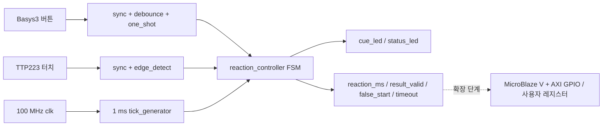

# CAPSTONE-05 — 터치·버튼 이중 입력 반응시간 측정기

[캡스톤 목록](README.md) · [독립 HTML](capstone-05-touch-reaction-timer.html) · [TTP223 기술자료](../gpio/ttp223.md) · [기본 버튼·LED](../gpio/basic-io.md)

**고유 과제:** Basys3에서 TTP223 정전식 터치 감지와 내장 버튼을 독립 입력으로 사용해 시각 자극 후 반응시간을 측정하고, 조기 입력·무응답을 판정하는 교육용 계측 시스템. **자체 창작 설계**, 공개 원본 코드·이미지·배선도 복제 없음.

**현재 검증 단계:** 문서·독립 HTML 작성. 신규 통합 RTL, TB, Vivado 합성, Timing, 실물 보드 시험은 아직 수행하지 않았다.

## 1. 문제와 입출력

임의 지연 뒤 LED가 켜지면 터치 센서를 누른 시간을 계측한다. 버튼은 새 라운드 시작·재설정용이며, 터치 입력을 버튼과 구분해 반응시간 계측과 부정 출발 판정을 분리한다.

| 구분 | 신호(설계용) | 기능·기준 |
|---|---|---|
| clk | clk | Basys3 보드 100 MHz 클록; 실제 XDC는 사용 보드에서 확인 |
| reset | reset | 동기 리셋(입력 버튼 사용 시 동기화·디바운스 필요) |
| 시작 | start_pulse | 내장 버튼의 디바운스 후 단발 펄스 |
| 반응 | touch_sync | TTP223 디지털 출력, 2단 동기화 + 상승 에지 검출 |
| 자극 | cue_led | 측정 시작 시 LED ON |
| 상태 | status_led[3:0] | IDLE/WAIT/MEASURE/RESULT/FAULT 구분 |
| 결과 | reaction_ms[15:0] | 자극 이후 최초 유효 터치까지 경과한 밀리초, 0~5000 |
| 결과 유효 | result_valid | RESULT 상태의 유지 레벨, 다음 시작/리셋 시 해제 |
| 조기 입력 | false_start | 자극 전 터치 상승을 감지하면 1로 유지 |
| 시간 초과 | timeout | 자극 후 5초간 입력 없으면 1로 유지 |

TTP223 출력 극성은 모듈 패드 설정과 제조사 변형에 따라 달라질 수 있으므로 실제 출력 HIGH/LOW 동작 확인 후 극성을 설정한다. 터치 모듈은 반드시 3.3V 공급·출력 HIGH를 확인한 뒤 Basys3 GPIO에 연결한다.

## 2. 기능 구조

**Top 원칙:** 보드 핀, wire, 인스턴스 연결만 담당. FSM, 시간계측, 표시 우선순위는 독립 Controller 안에서 처리한다.

## 3. FSM 및 계측 정책

| 상태 | 동작 | 다음 상태 |
|---|---|---|
| IDLE | LED OFF, 결과 초기 상태. start_pulse 대기 | 시작 → WAIT |
| WAIT | LED OFF, 1000~3000ms 준비 지연. 터치 상승 시 false_start 래치 | 조기 입력 → FAULT; 준비 완료 → MEASURE |
| MEASURE | cue_led ON, 1ms tick마다 계수. 첫 터치 상승 시 결과 확정 | 터치 → RESULT; 5000ms 도달 → FAULT |
| RESULT | cue_led OFF, 결과·result_valid 유지 | 새 시작 → WAIT |
| FAULT | cue_led OFF, false_start 또는 timeout 유지 | 새 시작 → WAIT |

- 지연시간은 최초 교육 실습에서 2000ms **고정**으로 시작한다. 이후 LFSR(선형 피드백 시프트 레지스터, 의사난수 생성기) 기반 1000~3000ms 변형을 선택 과제로 둔다. 고정 지연은 예측 가능하므로 실제 반응시간 실험의 무작위 자극이라고 주장하지 않는다.
- 버튼과 터치가 동시에 발생할 때 IDLE/RESULT의 시작 입력을 우선하고, WAIT/MEASURE에서는 터치 판정을 우선한다.
- WAIT→MEASURE 전이 클록에 터치가 이미 HIGH이면 부정 출발로 판정하고, 자극을 표시하지 않는다. 이를 명시적으로 테스트한다.
- 터치 입력은 기계적 바운스가 없다고 가정하지 않고 2단 동기화 뒤 안정시간(예: 20ms) 필터를 검토한다. 디바운스 지연은 실제 반응시간에 영향을 주므로 측정값의 편향으로 명시한다.
- 반응시간은 1ms 양자화 오차가 있으며, 동기화/필터 지연이 추가된다. **정밀 의학적 반응시간 측정 장치가 아니다.**

## 4. 구현 단계

1. TTP223 실제 보드의 VCC, GND, OUT 극성 및 3.3V 신호를 실측하고, Basys3 버튼·LED만으로 IDLE/WAIT/MEASURE/RESULT 순서부터 시뮬레이션한다.
2. `tick_1ms`를 100 MHz 기준 100000클록마다 생성하고, TB에서는 파라미터로 클록 수를 줄여 시간 테스트를 가속한다.
3. `touch_sync`와 `start_pulse`를 독립 인터페이스로 만들고, `reaction_controller`를 별도 파일에 구현한다.
4. 첫 단계는 LED + 상태 출력만, 두 번째 단계는 TTP223 + 버튼 2입력·결과 레지스터로 확장한다.
5. RTL 검증 후 기존 AXI GPIO를 사용해 결과/상태를 읽는 SoC 경로를 추가한다. 필요할 때만 독립 사용자 AXI4-Lite IP를 작성한다.

## 5. 테스트 시나리오 (미실행, 기대값)

| 번호 | 입력 시나리오 | 기대 결과 |
|---|---|---|
| T01 | Reset → 시작 없음 | IDLE, cue_led=0, result_valid=0 |
| T02 | 시작 → WAIT 중 터치 | FAULT, false_start=1, cue_led=0 |
| T03 | 시작 → WAIT 2000ms 경과 | MEASURE, cue_led=1 |
| T04 | 자극 후 350ms에 터치 상승 | RESULT, reaction_ms 약 350, result_valid=1 |
| T05 | MEASURE 5000ms 무응답 | FAULT, timeout=1, cue_led=0 |
| T06 | 터치 HIGH 유지/반복 상승 | 최초 상승 1회만 결과에 반영 |
| T07 | WAIT 종료 경계에서 터치 HIGH | FAULT, false_start=1 |
| T08 | RESULT 또는 FAULT에서 새 시작 | 이벤트·결과 초기화 후 WAIT |
| T09 | 비동기 터치 전이 | 2단 동기화·필터 후 단발 이벤트 |
| T10 | Reset 도중 MEASURE | 즉시 IDLE 복귀, 이전 결과 무효 |

## 6. MicroBlaze V SoC 확장안 (미구현)

AXI GPIO로 `reaction_ms[15:0]`, `result_valid`, `false_start`, `timeout`을 읽고, AXI GPIO 출력으로 `start`를 제어한다. IRQ(인터럽트 요청)는 선택 확장. 사용자 AXI4-Lite를 만들 경우 32비트 정렬 오프셋 `0x00 CTRL`(start W1P), `0x04 STATUS`(RO), `0x08 REACTION_MS`(RO), `0x0C IRQ_ENABLE`(RW)을 제안한다. 주소는 **설계안**이며 실제 IP/주소 배정·C 드라이버·버스 검증은 없다.

## 7. 전기 안전과 출처

- [TTP223 기술자료](../gpio/ttp223.md), [Basys3 기본 I/O](../gpio/basic-io.md) 및 [주변모듈 검증 기록](../VERIFICATION.md)을 참고한다. 실물 부품은 보드 변형별 VCC·OUT 전압을 별도로 확인한다.
- Basys3 GPIO는 3.3V 기준. 5V 신호를 직접 입력하지 않는다. XADC 단극성 0~1V 범위는 이 캡스톤에서 사용하지 않는다.
- [Arduino 공식 하드웨어 문서](https://docs.arduino.cc/hardware/), [Freenove Ultimate Starter Kit](https://github.com/Freenove/Freenove_Ultimate_Starter_Kit), [Keyestudio 원본 저장소](https://github.com/keyestudio/KS5003-KS5004-Keyestudio-ESP32-42-in-1-Sensor-Kit)는 일반적인 실습 아이디어의 출처일 뿐이다. **원본 코드·사진·회로도는 재사용하지 않았으므로 라이선스 부여 여부를 추정하지 않는다.** 외부 자료의 라이선스 조건은 해당 원본 저장소에서 별도 확인해야 한다.

## 8. 검증 상태

| 단계 | 상태 |
|---|---|
| 고유 기능 정의·신호표·FSM·구조도·TB 계획 | 작성 |
| 신규 통합 RTL 및 self-checking TB | 미구현·미실행 |
| Vivado 합성·Timing·XDC | 미실시 |
| MicroBlaze V AXI 연결·C 코드 | 설계안, 미구현 |
| 실제 TTP223/Basys3 측정 | 미실시 |
