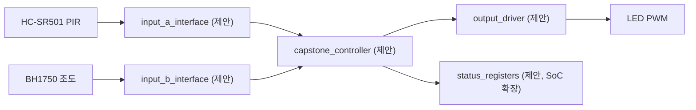

# CAPSTONE-06 — 움직임·조도 융합 야간 복도 조명

[캡스톤 목록](README.md) · [독립 HTML](capstone-06-night-hallway.html) · [주변모듈 기술자료](../README.md)

**분류:** 독립 창작·응용 융합형 캡스톤. **현재 상태: 설계안 작성 완료 / 신규 통합 RTL·C·AXI·Vivado·실물 시험 미실시.**

## 1. 실제로 만드는 시스템
- 입력 A: [HC-SR501 PIR](../gpio/hc-sr501.md)
- 입력 B: [BH1750 조도](../i2c/sensors.md)
- 출력: [LED PWM](../gpio/basic-io.md)
- 핵심 동작: 어두운 시간에 움직임이 검출되면 조명을 켜고, 재검출 시 유지시간을 연장한다.
- Basys3 단독 RTL → MicroBlaze V + AXI 레지스터 확장 순으로 구현한다.

## 2. 하드웨어와 신호 흐름

위 인터페이스·모듈명은 **신규 설계용 이름**이며, 실제 저장소에 동일한 RTL 포트나 파일이 있다고 주장하지 않는다.

## 3. 제어 정책 및 FSM
| 상태 | 진입 조건 | 출력·다음 상태 |
|---|---|---|
| IDLE | Reset 후 | 안전 출력 유지, 입력 유효 대기 |
| CHECK | 입력 A 또는 B 이벤트 | 두 입력의 유효값·순서·타임아웃 확인 |
| ACTIVE | 정책 조건 성립 | LED PWM 구동, 상태 기록 |
| HOLD | 동작 완료 또는 유지 조건 | 재진입·채터링 방지, 종료 대기 |
| FAULT | 입력 오류·타임아웃·전원 안전 위반 | 안전 출력 및 오류 래치, 명시적 복귀 |

**정책 상세:** 어두운 시간에 움직임이 검출되면 조명을 켜고, 재검출 시 유지시간을 연장한다.

## 4. 구현 단계
1. 센서·출력 모듈의 실제 IC/기판, VCC, I/O HIGH, 풀업, 구동 전류 확인
2. 각 입력의 유효 펄스·샘플 주기·동기화·Reset 및 오류 상태 정의
3. 기능별 Controller와 출력 Driver를 Top과 분리하여 RTL 구현
4. 입력 A만, B만, 순서 반대, 동시 입력, 타임아웃, Reset, 경계값 TB 작성
5. 실제 사용되는 IP에 한해 AXI GPIO 또는 사용자 AXI4-Lite Register Map 추가
6. Vivado 합성·Timing·보드 시험을 별도로 기록하고 검증된 결과만 배포

## 5. 검증 시나리오
- Reset에서 출력이 안전 상태인지 확인
- 입력 A만 발생 / 입력 B만 발생 / A→B / B→A / 동시 발생
- 정상 동작 중 재입력·바운스·센서 무효값·타임아웃
- 정책 충족·불충족 시 출력 구동과 상태 레지스터 일치
- 보드 연결 전 각 핀의 실제 전압·전류·드라이버 적합성 확인

## 6. 전기 안전과 원본 구분
Basys3 GPIO는 3.3V 기준. HC-SR04 일반형 ECHO 5V 직접 연결 금지; XADC 단극성 입력은 0~1V 범위를 지켜야 한다. 서보·모터·릴레이는 FPGA GPIO에서 전력을 공급하지 않고 외부 전원·구동 회로·공통 접지/절연 조건을 확인한다. I²C 모듈은 칩과 브레이크아웃의 전원·풀업 전압을 각각 확인한다.

이 과제의 기능 조합·FSM·실습 시나리오는 자체 작성했다. 연결한 기존 기술자료는 참고 근거이며 공개 튜토리얼의 코드·이미지·회로도를 복제하지 않았다.

## 7. 검증 상태
| 단계 | 상태 |
|---|---|
| 교육용 설계서·독립 HTML | 생성됨 |
| 기존 개별 모듈 기술자료 | 링크로 참조, 실제 변형별 확인 필요 |
| 신규 통합 RTL·테스트벤치 | 미구현 |
| C 드라이버·AXI 통합 | 미구현 |
| RTL 시뮬레이션·합성·Timing | 미실시 |
| Basys3 실물 검증 | 미실시 |
