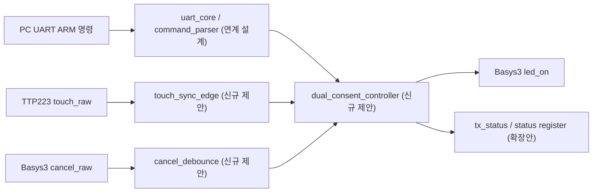
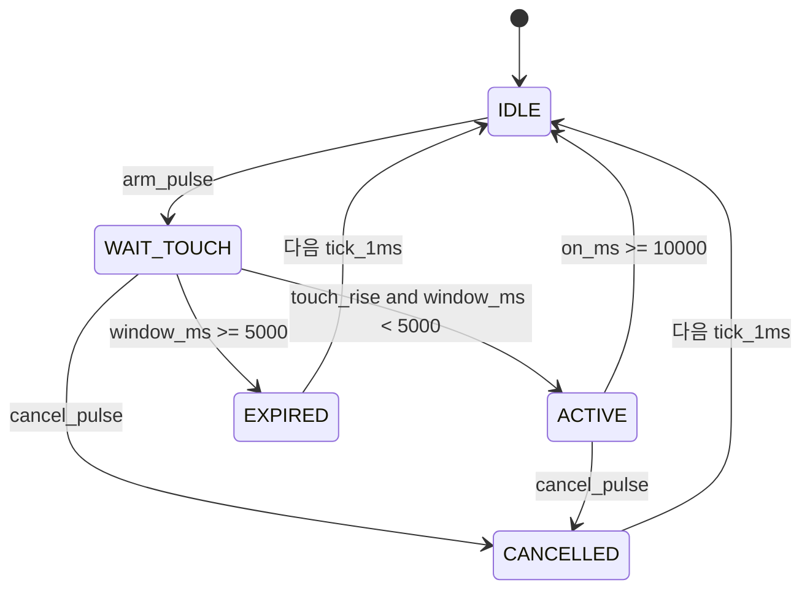

# CAPSTONE-09 — UART·터치 이중 승인 저전압 타이머 스위치

[캡스톤 목록](README.md) · [독립 HTML](capstone-09-dual-consent-timed-switch.html) · [SVG 구조도](capstone-09-dual-consent-timed-switch.svg) · [구조화 JSON](capstone-09-dual-consent-timed-switch.json)

**ID:** CAPSTONE-09 · **분류:** 통신+사용자 승인+시간 제한 안전제어 · **단계:** 설계형 캡스톤 · **선수학습:** RTL UART RX/명령 파서, 입력 동기화, FSM, 카운터, AXI GPIO/레지스터 맵.

**목표:** PC 터미널에서 `ARM\n` 명령을 받은 뒤 5초 이내에 TTP223 터치 센서로 현장 승인을 받아야만 Basys3 내장 LED가 10초간 켜지는 **저전압 작업 승인 타이머**. 승인 없이 켜지지 않으며 중복 입력·타임아웃·Reset 시 안전 상태로 복귀한다. **릴레이·모터·상용전원은 이번 단계에서 연결하지 않는다.**

**검증 단계:** 교육용 설계·도식·시험 시나리오 작성. 신규 통합 RTL/TB, 시뮬레이션, 합성, Timing, 보드 실증은 **미실시**. 기존 UART/센서 자료 존재와 신규 통합 성공은 다르다.

## 1. 하드웨어·전원·I/O

| 장치 | 신호/연결 | 전원·안전 |
|---|---|---|
| PC 터미널 | UART 8N1, 115200 bps 예시 → 보드 USB-UART RX | 실제 보드 핀은 Basys3 XDC 확인, 터미널 설정 일치 |
| TTP223 | `touch_raw` → 2FF 동기화·엣지 검출 | 3.3V 공급, 해당 보드 출력 HIGH/극성/토글 점퍼 확인 전 연결 금지. 5V 출력 직접 입력 금지 |
| Basys3 버튼 | `cancel_raw` → 동기화·디바운스 | 내장 버튼, 언제나 취소 우선 |
| Basys3 LED | `led_on` | 내장 LED만 사용, 외부 부하 없음 |
| UART TX | `tx_status` | 선택적 ASCII 응답: ARMED, ON, OFF, TIMEOUT, CANCEL |
| MicroBlaze V | AXI GPIO 또는 신규 AXI4-Lite | **후속 설계안**, 이번 RTL 구현·주소 배정 없음 |

TTP223는 저전력 모드 반응이 느릴 수 있으므로 5초 승인 창을 교육용 기본값으로 둔다. 부팅 직후 터치가 유지되면 새 승인 엣지로 인정하지 않는다.

## 2. 블록도

[실제 SVG 보기](capstone-09-dual-consent-timed-switch.svg). 위 모듈명은 인터페이스 설계안이며 기존 소스 파일명·포트명과 동일하다고 주장하지 않는다.

## 3. 신호표

| 이름 | 방향/폭 | 의미 |
|---|---|---|
| `clk`, `rst` | 입력 1bit | 기준 클록, 동기식 리셋 설계 |
| `arm_pulse` | 입력 1bit | UART 파서가 완전한 ARM 명령 수신 시 1클럭 |
| `touch_rise` | 입력 1bit | 동기화된 터치 0→1 단발 펄스 |
| `cancel_pulse` | 입력 1bit | 디바운스 완료된 버튼 취소 |
| `tick_1ms` | 입력 1bit | 클록 기반 1ms 시간 기준 |
| `led_on` | 출력 1bit | 허가된 10초 동안만 HIGH |
| `state[2:0]` | 출력 3bit | IDLE/WAIT_TOUCH/ACTIVE/EXPIRED/CANCELLED |
| `event_valid`, `event_code[2:0]` | 출력 | 상태 변경 이벤트 (SoC 확장용) |

## 4. FSM·정확한 제어 정책

- **취소 우선순위:** `rst` > `cancel_pulse` > 시간 만료 > 터치 승인 > `arm_pulse`. 취소가 들어온 클록에 `led_on`은 LOW가 되어야 한다(등록 출력은 해당 클록 엣지 이후).
- `IDLE`에서만 `arm_pulse` 수락. `WAIT_TOUCH` 및 `ACTIVE`의 중복 ARM은 무시하며 타이머를 연장하지 않는다.
- `WAIT_TOUCH` 진입 시 `window_ms` 0으로 초기화. 5000번째 1ms tick이 만료 우선이므로 경계에서 터치 입력은 거절한다.
- `ACTIVE` 진입 시 `on_ms` 0으로 초기화. 10000번째 tick에 LED OFF. `touch_rise`로 연장 불가.
- `touch_rise`만 유효하다. UART ARM 이전부터 눌린 터치의 HIGH 레벨은 승인하지 않는다.
- UART 파서는 CRLF/개행 경계, 최대 명령 길이, 잘못된 문자, FIFO overflow를 별도 정의하고 **완전한 `ARM\n`에만** `arm_pulse`를 출력한다.
- 전원 차단이나 FPGA 재구성 중 LED가 실제 안전 출력으로 유지된다는 보장은 없으므로 산업용 안전 인터록이 아니다.

## 5. RTL → AXI → SoC 확장

1. Basys3 내장 버튼·LED만으로 타이머 FSM/TB 작성 (외부 모듈 없이 시작).
2. 기존 UART RX 코어/파서의 **실제 포트명을 확인한 뒤** `arm_pulse`를 연결한다. `touch_sync_edge`·`cancel_debounce`·`dual_consent_controller`를 독립 모듈로 구현하고 Top은 포트 연결만 담당.
3. TTP223 실제 기판 3.3V·출력 극성 확인 후 입력 연결.
4. 선택: 이벤트/상태 레지스터 오프셋 `0x00 CTRL`, `0x04 STATUS`, `0x08 EVENT_PENDING`(W1C), `0x0C TIMEOUT_MS` (제안, 미구현). 이벤트와 W1C 동시 발생은 Set 우선.
5. MicroBlaze V: 기초 AXI GPIO 제어 → 독립 AXI4-Lite 슬레이브로 확장. AW/W 독립 수락, WSTRB, 응답 백프레셔, CDC/Reset, 주소 정렬·범위를 검증한 후 통합.

## 6. 자가검증 TB 시나리오 (실행 전)

| 번호 | 자극 | 기대값 |
|---|---|---|
| T01 | Reset | IDLE, led_on=0 |
| T02 | ARM 후 100ms 터치 상승 | ACTIVE, led_on=1 |
| T03 | ARM 없이 터치 상승 | IDLE, led_on=0 |
| T04 | ARM 후 5000ms 경과 | EXPIRED, led_on=0 |
| T05 | 만료 tick과 터치 동시 | 만료 우선, led_on=0 |
| T06 | ACTIVE 중 ARM 반복 | ON 타이머 연장 없음 |
| T07 | ACTIVE 중 취소 | CANCELLED, led_on=0 |
| T08 | 터치 HIGH 유지 후 ARM | 새 상승 없으면 미승인 |
| T09 | ACTIVE에서 10000ms | IDLE, led_on=0 |
| T10 | WAIT_TOUCH에서 Reset | IDLE, 카운터 0 |
| T11 | UART 잘못된 명령/CRLF | 파서 정책에 따라 거부/정상 인식, 임의 ARM 금지 |
| T12 | ARM·취소 동시 | 취소 우선, LED OFF |

**통과 조건:** 각 테스트를 self-checking assertion으로 작성해 실패 시 비정상 종료. 현재 실제 TB 실행 결과는 없다.

## 7. 출처·라이선스 및 차별성

- [TTP223 기술자료](../gpio/ttp223.md): 기존 저장소의 D3 근거. 원본 칩 데이터시트·보유 보드 실측은 미확인.
- [UART 인터페이스](../uart/README.md) · [RTL 학습 트랙](../../rtl/README.md) · [SoC 맵](../../soc-map/README.md): 재사용 검토 대상, 신규 통합 검증을 의미하지 않는다.
- [Arduino Hardware 공식 자료](https://docs.arduino.cc/hardware/): 범용 참고 출처. [Keyestudio](https://github.com/keyestudio/KS5003-KS5004-Keyestudio-ESP32-42-in-1-Sensor-Kit)·[Freenove](https://github.com/Freenove/Freenove_Ultimate_Starter_Kit) 원본 코드/이미지/배선도는 **사용·복제하지 않음**. Keyestudio 재배포 라이선스 미확인, Freenove는 저장소별 라이선스 조건 재확인 필요.
- 본 과제의 **UART 명령 + 현장 터치 이중 승인 + 시간 제한 LED 출력** 정책·도식·시험 시나리오는 자체 창작이며 CAPSTONE-01~08의 제목 변경판이 아니다.

## 8. 검증 단계와 미완료

| 단계 | 결과 |
|---|---|
| Markdown/HTML/SVG/JSON 생성 | 파일 존재 여부 및 링크 검사로 확인 |
| 3대 게이트(시각화·구조화·체계화) | 파일·필수 필드·도식 링크 검사 필요 |
| 신규 Controller RTL / TB | **미구현 / 미실행** |
| C/AXI/SoC 통합 | **미구현** |
| 합성·Timing·보드 시험 | **미실시** |
