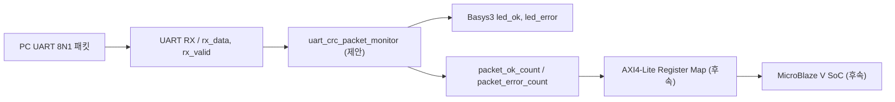

# CAPSTONE-10 — UART 프레임 CRC-8 무결성 감시·오류 계수기

[캡스톤 목록](README.md) · [독립 HTML](capstone-10-uart-crc-packet-monitor.html) · [SVG 구조도](capstone-10-uart-crc-packet-monitor.svg) · [JSON 메타데이터](capstone-10-uart-crc-packet-monitor.json)

**ID:** CAPSTONE-10 · **분류:** UART 통신·데이터 무결성·오류 진단 · **단계:** 설계형 캡스톤(기존 UART 학습자료 재사용) · **선수학습:** UART 8N1, Byte Stream, FSM, CRC, 타이머, Register Map.

**목표:** PC가 송신한 패킷을 Basys3 USB-UART로 수신하여 길이·CRC-8을 검사하고, 정상/오류 패킷 수를 LED와 상태 레지스터로 확인한다. 모터·릴레이·외부 센서 없이 안전하게 통신 검증을 연습한다. 기존 CAPSTONE-09의 이중 승인 타이머와 달리 **가변 길이 패킷 검증·재동기화·오류 통계**가 핵심이다.

**검증 단계:** 문서/구조도/시험 벡터 설계 완료. 신규 통합 RTL, 테스트벤치 실행, Vivado 합성·Timing, 보드 실증은 **미실시**. 아래 CRC 벡터는 명세에 근거한 설계 기대값이며 실행 결과가 아니다.

## 1. 시스템 블록도

[SVG 블록도](capstone-10-uart-crc-packet-monitor.svg)에는 동일한 제안 신호명 사용. **Top Module은 연결만 수행**하고 파싱·CRC·카운터·타임아웃 정책은 Controller에서 구현한다.

## 2. 패킷 규약 (자체 설계)

| 필드 | 길이 | 값/의미 |
|---|---|---|
| SOF | 1 byte | `0xA5` |
| LEN | 1 byte | 1~16 (payload 바이트 수) |
| PAYLOAD | LEN byte | 임의 바이너리 데이터, SOF와 같은 값도 허용 |
| CRC | 1 byte | LEN 및 PAYLOAD를 대상으로 CRC-8/ATM, 다항식 `0x07`, 초기값 `0x00`, 비트 반사 없음, 최종 XOR `0x00` |

SOF는 CRC 대상이 아니다. 프레임 중간의 `0xA5`는 데이터이며 새 SOF로 취급하지 않는다. UART 8N1/115200bps는 **교육용 기본 설정**, 실제 Basys3 USB-UART/XDC와 일치 여부를 확인한다. 20ms 동안 다음 바이트가 오지 않으면 불완전 패킷을 버리고 오류를 1회 기록한다.

**CRC 비트 알고리즘:** 각 입력 바이트마다 `crc ^= byte`; 8회 반복하여 최상위 비트가 1이면 `(crc << 1) ^ 8'h07`, 아니면 `crc << 1`(8비트 절단). 예시: LEN=1, PAYLOAD=0x00이면 CRC 기대값은 `0x07`(검증 전 설계 벡터). CRC 불일치·LEN 범위 오류·수신 타임아웃을 구분해 기록한다.

## 3. 입출력·전원·신호표

| 장치/신호 | 방향 | 설명·안전 |
|---|---|---|
| Basys3 USB-UART | PC↔보드 | 보드 내장 USB-UART 사용, 8N1. 외부 5V TTL UART를 FPGA GPIO에 직접 연결 금지 |
| `clk`, `reset` | 입력 | 100MHz 기준, 동기 reset 정책 |
| `rx_data[7:0]`, `rx_valid` | 입력 | UART RX Byte Stream (제안 포트). 입력 FIFO backpressure가 없다면 수신 오버런 감지 별도 필요 |
| `rx_ready` | 출력 | 1이면 수신 허용. UART 코어와의 핸드셰이크 계약은 통합 시 검증 |
| `led_ok`, `led_error` | 출력 | Basys3 내장 LED 2개, 마지막 패킷 판정 표시 |
| `packet_ok_count[15:0]` | 출력 | CRC/길이 정상 프레임 누적, 포화 카운트 |
| `packet_error_count[15:0]` | 출력 | CRC·길이·타임아웃 오류 누적, 포화 카운트 |
| `error_code[2:0]` | 출력 | 0=없음, 1=CRC, 2=LEN, 3=TIMEOUT, 4=OVERRUN(후속) |
| `clear_stats` | 입력 | 별도 동기 펄스, 카운터/표시 초기화. 진행 중 패킷은 유지 |

**전기 안전:** 내장 USB-UART와 내장 LED만 사용한다. Basys3 I/O는 3.3V이며, XADC(일반 단극성 0~1V), 외부 모터 전원, 5V 신호 연결은 이 과제에 필요하지 않다.

## 4. FSM(유한상태머신)·제어정책

| 상태 | 동작 | 전이 |
|---|---|---|
| `WAIT_SOF` | 0xA5가 아닌 바이트 무시 | SOF → `READ_LEN` |
| `READ_LEN` | LEN 수신, 1~16 확인, CRC 갱신 | 유효 → `READ_PAYLOAD`, 무효 → `ERROR` |
| `READ_PAYLOAD` | LEN개 바이트 수신·CRC 누적 | 모두 수신 → `READ_CRC` |
| `READ_CRC` | CRC 바이트와 계산값 비교 | 일치 → `ACCEPT`, 불일치 → `ERROR` |
| `ACCEPT` | 정상 카운터 증가, LED 갱신 | 다음 클럭 → `WAIT_SOF` |
| `ERROR` | 오류 코드·카운터 갱신 | 다음 클럭 → `WAIT_SOF` |

20ms 타임아웃은 `READ_LEN`/`READ_PAYLOAD`/`READ_CRC`에서 적용. 오류 발생 시 `ERROR`를 거쳐 **SOF 재탐색**하며 프레임 중간 SOF 바이트를 무조건 재시작 신호로 취급하지 않는다. `clear_stats`와 패킷 완료가 같은 클럭이면 **clear 우선**(카운터만 초기화); Reset은 상태·CRC·표시·통계를 초기화한다. 16비트 통계는 65535에서 포화한다.

## 5. 구현 순서

1. `rtl/rtl03_uart_led` 및 `devices/uart`의 기존 UART 자료를 읽고 실제 Byte Stream 신호명과 수신 준비 조건을 확인한다. 기존 32차시 소스는 변경하지 않는다.
2. 별도 `uart_crc_packet_monitor.v`(신규 제안) 구현: SOF/LEN/PAYLOAD/CRC FSM, 타임아웃, 카운터, LED 상태.
3. `tb_uart_crc_packet_monitor.v`(신규 제안) 작성: 정상/오류/경계/Reset/clear_stats/연속 프레임 자동 채점.
4. Basys3 Top은 UART RX Core, Controller, LED 연결만 수행하고 XDC의 실제 핀을 확인한다.
5. 확장 A: MicroBlaze V + AXI UART Lite로 프레임 수신 및 C 코드 CRC 검증. 확장 B: 자체 RTL Controller + AXI4-Lite 통계 Register Map 및 IRQ(설계안). AXI UART Lite의 보레이트는 IP 구성 시 설정되므로 임의 런타임 변경을 가정하지 않는다.

## 6. 제안 Register Map (AXI 확장, 미구현)

| 오프셋 | 이름 | 접근 | 의미 |
|---|---|---|---|
| 0x00 | STATUS | RO | bit0 last_ok, bit1 last_error, bit2 busy |
| 0x04 | OK_COUNT | RO | [15:0] 정상 프레임 수 |
| 0x08 | ERROR_COUNT | RO | [15:0] 오류 프레임 수 |
| 0x0C | LAST_ERROR | RO | [2:0] 오류 코드 |
| 0x10 | CTRL | WO | bit0 W1P 통계 초기화 (WSTRB[0] 적용) |

AXI AW/W 독립 수락, WSTRB, B/R backpressure, Reset 및 동시 이벤트 처리 규칙은 신규 AXI 슬레이브 구현 후 검증해야 한다.

## 7. 자가검증 시험 시나리오 (미실행)

| ID | 입력 | 기대 결과 |
|---|---|---|
| T01 | Reset | WAIT_SOF, 카운터 0, LED OFF |
| T02 | `A5 01 00 07` | CRC 일치 → OK_COUNT +1 (벡터 검산 필요) |
| T03 | T02 마지막 CRC를 `00`으로 변조 | ERROR_COUNT +1, CRC 오류 |
| T04 | `A5 00` | LEN 오류 +1 |
| T05 | `A5 11` | LEN>16 오류 +1 |
| T06 | PAYLOAD에 `A5` 포함 | 새 SOF로 오인하지 않음 |
| T07 | `A5 02 11` 뒤 20ms 중단 | TIMEOUT 오류 +1 |
| T08 | 정상 패킷 연속 2개 | 정상 카운터 +2 |
| T09 | READ_PAYLOAD 중 Reset | 상태·CRC·카운터 초기화 |
| T10 | 카운터 65535에서 정상 패킷 | 포화 유지 |
| T11 | 정상 판정과 clear_stats 동시 | clear 우선, 카운터 0 |
| T12 | UART RX overflow 시뮬레이션 | 별도 오버런 경로 구현 전 미검증 |

**완료 판정 기준:** 신규 RTL 소스와 self-checking TB를 실제 실행하여 PASS 로그 확보 → 합성·Timing → 보드 UART 패킷 송수신 실측을 각각 분리 기록한다. 이 문서만으로 구현 완료가 아니다.

## 8. 출처·라이선스·검증 범위

- [기존 UART 기술자료](../uart/README.md)와 [RTL03 UART LED](../../rtl/rtl03_uart_led/README.md): 자체 저장소 재사용 후보이며 해당 RTL 통합 성공은 확인되지 않았다.
- [AMD AXI UART Lite PG142](https://docs.amd.com/r/en-US/pg142-axi-uartlite): AXI UART Lite 확장 참고.
- [CRC-8/ATM 정의 참고](https://reveng.sourceforge.io/crc-catalogue/all.htm#crc.cat.crc-8): 표준 파라미터를 기반으로 패킷 포맷과 FSM은 자체 설계.
- Keyestudio/Freenove/Seeed 외부 코드는 **이번 과제에 복제·포팅하지 않았다**. 공개 사례를 사용할 때 원본 URL·라이선스를 별도로 확인해야 하며 라이선스 미확인 자료는 링크만 사용한다.
- [적대적 검증 기록](../VERIFICATION.md): 주변모듈의 기존 RTL 검증은 본 캡스톤 신규 RTL 통합 성공을 의미하지 않는다.

**검증 상태:** Markdown/SVG/HTML/JSON 생성 여부는 GitHub 파일 확인으로 판정. 신규 RTL/TB 실행·합성·보드 검증은 미실시.
