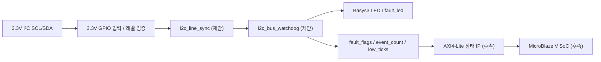
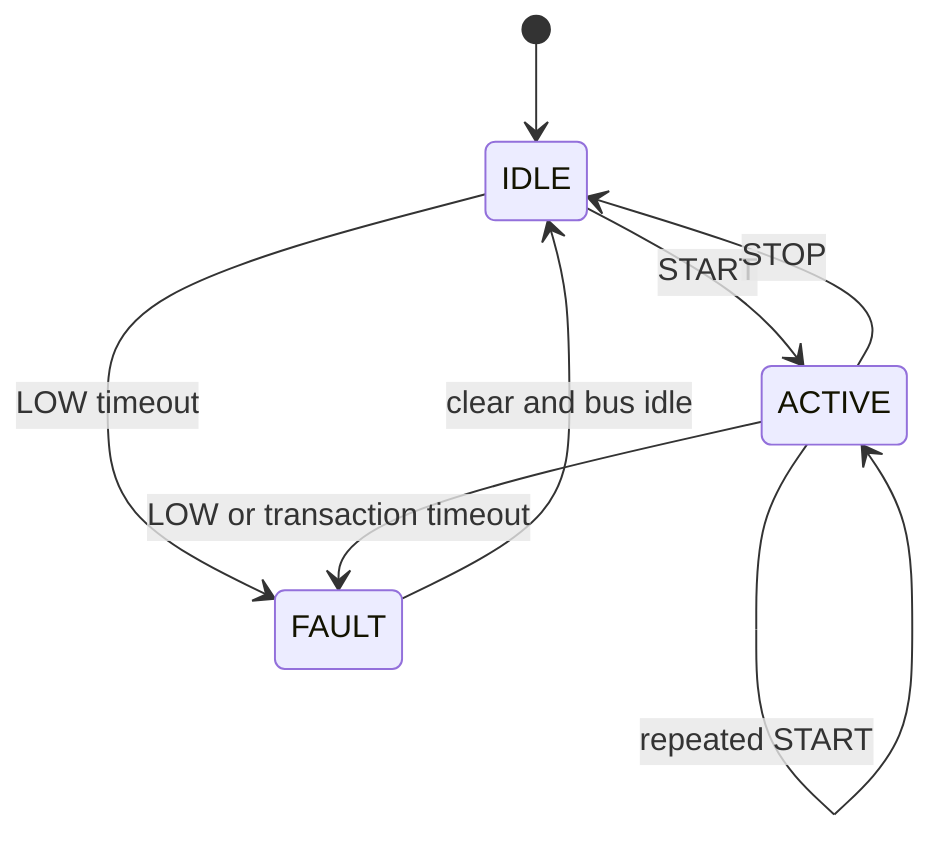

# CAPSTONE-12 — I²C 버스 응답 지연·장애 감시기

[캡스톤 목록](README.md) · [독립 HTML](capstone-12-i2c-bus-health-monitor.html) · [SVG 구조도](capstone-12-i2c-bus-health-monitor.svg) · [JSON 메타데이터](capstone-12-i2c-bus-health-monitor.json)

**고유 ID:** CAPSTONE-12 · **분류:** 디지털 통신 진단/예방정비 · **단계:** 설계형 · **선수학습:** 동기화, 오픈드레인, I²C START/STOP/ACK, 타이머, FSM, AXI4-Lite.

**목표:** Basys3가 3.3V I²C 버스의 SCL/SDA 상태를 **수동 관찰**하여 장시간 LOW, 버스 정지, START 이후 STOP 미검출을 경고하고 LED에 장애를 표시한다. 기존 캡스톤과 달리 **외부 센서를 제어하지 않는 비침습 버스 감시**가 핵심이다. 이 설계는 I²C 마스터/슬레이브가 아니라 별도 모니터이며 센서 응답의 의미나 ACK의 대상 주소를 해석하지 않는다.

**상태:** 자체 창작 설계 문서·SVG·HTML·JSON 작성. 신규 RTL/TB/합성/실물 보드 검증 **미실시**. 기존 `devices/i2c/`와 `soc-map/`은 참고자료이며, 검증된 I²C 감시 IP가 존재한다고 주장하지 않는다.

## 1. 시스템 블록도

[독립 SVG 구조도](capstone-12-i2c-bus-health-monitor.svg)는 동일한 제안 신호명을 사용한다. Top Module은 보드 핀·wire·모듈 인스턴스만 연결하고 감시 정책은 Controller에서 처리한다.

## 2. 부품·전원·연결

| 부품 | 역할 | 전기 조건 |
|---|---|---|
| Basys3 내장 100MHz 클록, LED | 타이밍·경고 | 보드 기본 전원 |
| 범용 3.3V I²C 센서 모듈 또는 테스트용 오픈드레인 신호원 | 관찰 대상 | **실제 기판의 풀업 전압 확인**; 센서 공급 전압과 신호 풀업은 별개 |
| SCL/SDA 관찰선 2개 | 읽기 전용 입력 | Basys3 GPIO 3.3V 초과 금지, 5V 풀업 직접 연결 금지 |
| 공통 GND | 신호 기준 | 외부 장치와 공통 접지, 역급전 주의 |

**금지:** Basys3가 SCL/SDA를 푸시풀 HIGH로 구동하거나 5V I²C 신호를 직접 입력받는 연결. 본 캡스톤의 GPIO는 **입력 전용**이며 버스에 추가 풀업을 임의 병렬 연결하지 않는다. XADC는 사용하지 않는다(일반 단극성 0~1V 제한을 GPIO와 혼동 금지).

## 3. 신호표 (신규 제안, 아직 RTL 포트 아님)

| 신호 | 방향/폭 | 의미 |
|---|---|---|
| `clk`, `rst` | 입력 / 1 | 100MHz, 동기 reset |
| `scl_in`, `sda_in` | 입력 / 1 | 3.3V 입력 전용 관찰 |
| `scl_sync`, `sda_sync` | 내부 / 1 | 2단 동기화 출력 |
| `sample_tick` | 내부 / 1 | 10µs 간격 감시 기준(100MHz / 1000) |
| `bus_busy` | 출력 / 1 | START 감지 후 STOP 전까지 1 |
| `fault_led` | 출력 / 1 | 장애 래치 상태 표시 |
| `fault_flags[2:0]` | 출력 / 3 | [0] SCL LOW 초과, [1] SDA LOW 초과, [2] 트랜잭션 미종료 |
| `event_count[15:0]` | 출력 / 16 | 장애 신규 발생 횟수, 포화 카운트 |
| `low_ticks[15:0]` | 출력 / 16 | 현재 연속 LOW 길이(10µs 단위), 포화 |
| `clear_pulse` | 입력 / 1 | 이벤트·래치 해제 요청, 새 장애 동시 발생 시 Set 우선 |

## 4. 제어정책과 FSM

**시간 기준(교육용 제안값):** `sample_tick` 10µs, SCL/SDA LOW 감시 임계 25ms(2500 tick), START 후 STOP 미검출 100ms(10000 tick). I²C 표준 전체에 적용되는 규정값이 아니라 실습용 장애 탐지 정책이다. 합법적인 clock stretching이나 느린 트랜잭션을 장애로 오판할 수 있으므로 임계값은 환경에 맞춰 설정해야 한다.

| 상태 | 조건 | 전이/동작 |
|---|---|---|
| `IDLE` | SCL=1에서 SDA 하강 | `ACTIVE`, 거래 시간계수 초기화 |
| `ACTIVE` | SCL=1에서 SDA 상승 | `IDLE`, 정상 STOP |
| `ACTIVE` | SCL=1에서 SDA 하강 | 반복 START로 보고 `ACTIVE` 유지 |
| `ACTIVE` | 100ms 동안 STOP 없음 | `FAULT`, bit2 Set |
| `IDLE` 또는 `ACTIVE` | SCL/SDA LOW가 25ms 초과 | `FAULT`, 해당 bit Set |
| `FAULT` | `clear_pulse` + 두 선 HIGH가 안정됨 | `IDLE`; 미해결 장애면 `FAULT` 유지 |

**동시성:** 두 선 LOW 장애가 같은 tick에 발생하면 두 비트를 모두 Set하되 이벤트 카운트는 그 tick에 한 번만 증가한다. `clear_pulse`와 장애가 겹치면 Set 우선. 버스 LOW가 지속되면 이벤트는 처음 한 번만 기록하고 해제 후 재발 시 다시 계수한다. START/STOP 검출은 동기화된 SCL HIGH 상태에서 SDA 변화로 판단하며 입력 전이의 동시 샘플링 한계를 테스트한다.

## 5. AXI4-Lite / SoC 확장 (미구현)

| 오프셋 | 이름 | 접근 | 의미 |
|---|---|---|---|
| 0x00 | `CTRL` | RW | bit0 enable, bit1 clear(W1P) |
| 0x04 | `STATUS` | RO | bit0 busy, bit1 fault |
| 0x08 | `FAULT_FLAGS` | RW1C | [2:0] 오류 원인, HW Set 우선 |
| 0x0C | `EVENT_COUNT` | RO | 16비트 포화 누적 |
| 0x10 | `LOW_TICKS` | RO | 10µs 단위 LOW 지속 |
| 0x14 | `IRQ_ENABLE` | RW | bit0 장애 IRQ 허용 |

버스의 AW/W 독립 수락, WSTRB, B/R backpressure, reset 및 W1C 우선순위는 **신규 AXI IP에서 별도 검증**한다. 기존 I²C/AXI IP 시험 성공을 이 신규 감시기로 전용하지 않는다.

## 6. 구현 순서

1. 3.3V I²C 신호원과 SCL/SDA 풀업 전압을 측정하고 입력 전용 연결 검토.
2. `i2c_line_sync` 2단 동기화, `sample_tick` 생성, START/STOP 검출기 구현.
3. `i2c_bus_watchdog` FSM과 LOW/거래 타임아웃, 이벤트 포화·Set 우선 구현.
4. Self-checking TB에서 100MHz 클록 기준 정상/오류/경계/Reset 시나리오 검증.
5. Top을 Shell/Wrapper로 구성하고 LED 확인. 실제 전압 승인 후 실물 시험.
6. AXI4-Lite Register Map과 MicroBlaze V C 드라이버, IRQ 처리 확장.

## 7. 테스트 시나리오 (기대값, 실행 결과 아님)

| ID | 입력 | 기대 결과 |
|---|---|---|
| T01 | Reset, SCL/SDA=1 | IDLE, flags=0, LED=0 |
| T02 | START→정상 데이터→STOP | ACTIVE→IDLE, flags=0 |
| T03 | 반복 START→STOP | 거래 유지 후 정상 종료 |
| T04 | SCL LOW 24.99ms | 오류 없음 |
| T05 | SCL LOW 25.01ms | bit0 Set, LED=1 |
| T06 | SDA LOW 25.01ms | bit1 Set |
| T07 | START 후 STOP 100.01ms 미검출 | bit2 Set |
| T08 | LOW 유지 1초 | 최초 1회만 event_count 증가 |
| T09 | clear와 새 fault 동시 | 새 fault 보존 |
| T10 | 두 선 동시 LOW 초과 | flags[1:0] 둘 다 Set, 1회 이벤트 |
| T11 | 포화 카운터 최대값+새 장애 | 0xFFFF 유지 |
| T12 | Reset during ACTIVE/FAULT | 출력·계수·상태 초기화 |
| T13 | 5V 풀업 장치 | **연결 금지**; 실물 시험 전 전압 검사 실패 처리 |

## 8. 근거·라이선스·검증 게이트

- [주변 I²C 기술자료](../i2c/README.md) · [SoC 대응](../../soc-map/README.md) · [적대적 검증](../VERIFICATION.md).
- 외부 공개 예제의 코드·그림을 복제하지 않은 **자체 작성 프로젝트**. 참고자료는 링크만 제공하며 외부 코드/이미지의 재배포 라이선스는 확인된 것으로 간주하지 않는다.
- G1 시각화: Mermaid + SVG·HTML · G2 구조화: 신호/FSM/테스트/JSON · G3 체계화: 번호/선수학습/RTL→AXI→SoC/목차.
- **검증 구분:** 문서·링크 정적 검사와 RTL 시뮬레이션, 합성·Timing, 실물 보드 실증은 서로 독립 단계. 이 과제의 신규 RTL·TB는 미구현, 따라서 실행 성공 주장 금지.
