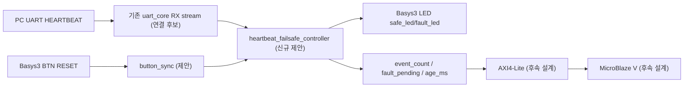

# CAPSTONE-13 — UART 하트비트 감시·안전 정지 상태기

[캡스톤 목록](README.md) · [독립 HTML](capstone-13-uart-heartbeat-failsafe.html) · [SVG 구조도](capstone-13-uart-heartbeat-failsafe.svg) · [JSON 메타데이터](capstone-13-uart-heartbeat-failsafe.json)

**고유 ID:** CAPSTONE-13 · **분류:** UART 통신 안전·장애 복구 · **단계:** 설계형 · **선수학습:** UART 8N1, 동기화, 카운터, FSM, Byte Stream ready/valid, AXI4-Lite.

**목표:** PC가 주기적으로 보내는 단일 바이트 `0x48`(ASCII H) 하트비트를 감시한다. 마지막 정상 수신 후 1500ms 동안 유효 하트비트가 없으면 안전 정지 상태를 래치하고 Basys3 LED로 표시한다. 실제 모터·릴레이를 구동하지 않는다. 이전 UART CRC 패킷 검사·이중 승인 타이머 과제와 달리 **통신 단절 후 fail-safe 상태 유지와 명시적 복구 절차**가 핵심이다.

**상태:** 신규 설계 문서/도식 작성. 신규 RTL·TB·합성·보드 시험 **미실시**. 기존 UART RTL은 재사용 후보이며 실제 포트와 연결 적합성은 구현 시 확인한다.

## 1. 시스템 블록도

Top Module은 보드 핀·wire·인스턴스 연결만 담당한다. 제어정책은 `heartbeat_failsafe_controller`에 둔다. SVG와 HTML은 같은 제안 신호명을 사용한다.

## 2. 부품·전원

| 부품 | 역할 | 전기 조건 |
|---|---|---|
| Basys3 내장 USB-UART | PC 하트비트 수신 | 보드 내장 UART 경로, XDC 확인 |
| Basys3 LED 2개 | 정상/장애 표시 | 보드 내장 LED만 사용 |
| Basys3 BTN | 장애 복구 요청 | 내부 동기화 및 디바운스 필요 |
| 외부 장치 | 사용하지 않음 | 5V GPIO, 모터, XADC 연결 없음 |

## 3. 입력·출력·신호표 (제안 포트, 아직 실제 RTL 아님)

| 신호 | 방향·폭 | 설명 |
|---|---|---|
| `clk`, `rst` | 입력 1bit | 100MHz 기준, 동기식 reset 제안 |
| `rx_out_data` | 입력 8bit | 기존 UART RX stream byte 연결 후보 |
| `rx_out_valid` | 입력 1bit | RX byte 유효 |
| `rx_out_ready` | 출력 1bit | 컨트롤러 수신 허용; 항상 수용 가능한 구조부터 시작 |
| `reset_pulse` | 입력 1bit | 디바운스된 BTN 복구 요청 |
| `safe_led` | 출력 1bit | RUN에서만 HIGH |
| `fault_led` | 출력 1bit | FAULT에서 HIGH |
| `fault_pending` | 출력 1bit | 래치된 타임아웃 이벤트 |
| `age_ms` | 출력 16bit | 마지막 H 이후 경과 시간, 1500에서 포화 |
| `event_count` | 출력 16bit | FAULT 진입 횟수, 최대 65535 포화 |

**프로토콜:** `0x48`만 정상 하트비트. 다른 바이트는 하트비트 타이머를 갱신하지 않는다. 수신 바이트의 의미는 UART 8N1 설정이 맞을 때만 유효하다. UART framing error 검출은 RX IP 제공 기능에 따라 별도 확장한다.

## 4. 제어 정책 및 FSM

| 상태 | 진입 조건 | 동작 | 전이 |
|---|---|---|---|
| `WAIT_FIRST` | Reset 후 | 안전 LED OFF, fault LED OFF, 카운터 0 | H 수신 → RUN |
| `RUN` | 최초 H 수신 | safe LED ON, `age_ms` 1ms마다 증가 | H 수신 → age 0 / 1500ms 경과 → FAULT |
| `FAULT` | 타임아웃 | safe LED OFF, fault LED ON, pending 1, event_count +1(진입 시 1회) | `reset_pulse` → WAIT_FIRST |

**안전 우선:** FAULT에서는 H만 수신해도 자동 복귀하지 않는다. 복구 버튼을 누른 뒤 **새 H**를 받아야 RUN으로 진입한다. RUN에서 1500ms 만료와 H가 같은 클록에 들어오면 **타임아웃 우선**으로 FAULT 진입한다. 타이머는 100MHz에서 100000클록마다 1ms tick을 생성한다. 임계값은 교육용이며 산업용 안전 인증이 아니다.

## 5. 구현 순서

1. 기존 [UART RTL 트랙](../../rtl/README.md)의 RX Byte Stream 포트·ready/valid 타이밍과 Basys3 UART XDC 확인.
2. 1ms clock enable 생성(클록 분주 신규 도메인 생성 금지), `heartbeat_failsafe_controller` FSM 및 포화 카운터 구현.
3. `tb_heartbeat_failsafe_controller`에서 Reset, 정상 H, 다른 바이트, 1499/1500ms 경계, 동일 클록 동시 이벤트, FAULT 래치, 복구, 포화 시험.
4. Basys3 Top은 연결만 구현. UART RX FIFO 소비와 ready/valid 수락 시점을 확인.
5. AXI4-Lite 확장 시 `STATUS` RO, `AGE_MS` RO, `EVENT_COUNT` RO, `EVENT_PENDING` W1C를 별도 IP로 구현. WSTRB, AW/W 독립 수락, 동시 set/clear 우선순위 시험.
6. MicroBlaze V C 드라이버로 상태 읽기 및 이벤트 로깅. Address Editor 실제 주소는 프로젝트에서 확정.

## 6. 시험 시나리오 (기대 결과, 실행하지 않음)

| 번호 | 자극 | 기대 결과 |
|---|---|---|
| T01 | Reset | WAIT_FIRST, LED 둘 다 OFF, pending=0 |
| T02 | 최초 H | RUN, safe_led=1 |
| T03 | 1초 간격 H 10회 | RUN 유지, event_count=0 |
| T04 | H 없이 1499ms | RUN 유지 |
| T05 | H 없이 1500ms | FAULT, fault_led=1, count=1 |
| T06 | FAULT에서 H 반복 | FAULT 유지 |
| T07 | FAULT에서 reset_pulse | WAIT_FIRST, 자동 RUN 금지 |
| T08 | reset 후 새 H | RUN 재진입 |
| T09 | RUN 중 다른 바이트 | age 갱신 없음 |
| T10 | 만료와 H 동시 | 타임아웃 우선 FAULT |
| T11 | count 최대값 후 재진입 | 65535에서 포화 |
| T12 | RX valid 유지, ready handshake | 같은 byte 중복 처리 없음 |

## 7. 출처·라이선스·검증 단계

- 기존 프로젝트 [UART RTL 학습 트랙](../../rtl/README.md)과 [주변모듈 UART 자료](../uart/README.md)를 내부 기술자료로 참조한다.
- 공개 Arduino/Keyestudio/Freenove/Seeed 코드를 복제하지 않은 **독립 창작 설계**다. 외부 코드·사진·배선도 재배포 없음.
- 참고: [AMD MicroBlaze V](https://www.amd.com/en/products/adaptive-socs-and-fpgas/intellectual-property/microblaze-v.html) (실제 IP 설정은 별도 검증).
- 검증 단계: 문서 작성 → 구조/링크 정적검사(실행 결과 별도 기록) → RTL Simulation(미실시) → Synthesis/Timing(미실시) → Board Test(미실시).
- 산업 안전 정지 회로로 사용 금지. 이 과제의 안전 정지는 **보드 내장 LED 상태 표시만** 의미한다.
