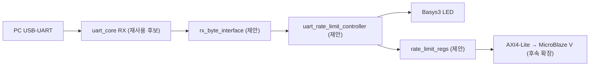

# CAPSTONE-15 — UART 명령 속도 제한·과부하 차단기

[캡스톤 목록](README.md) · [독립 HTML](capstone-15-uart-rate-limiter.html) · [SVG 구조도](capstone-15-uart-rate-limiter.svg) · [JSON 메타데이터](capstone-15-uart-rate-limiter.json)

**고유 ID:** CAPSTONE-15 · **분류:** 통신 신뢰성/보안·RTL 독립 설계 · **단계:** 설계형 캡스톤 · **상태:** 문서 설계안, 신규 RTL/보드 미검증

## 1. 목표와 선수학습
PC가 UART로 연속 명령을 보내도 FPGA가 설정한 처리 예산을 초과하는 명령을 차단한다. 잘못된 명령이나 폭주가 LED 출력 정책을 우회하지 못하도록 한다. 선수학습: UART RX/valid-ready, 동기식 FSM, 타이머, 카운터, 레지스터 맵.

## 2. 부품·전원·입출력
- Basys3(3.3V I/O), 보드 USB-UART 연결 PC, 내장 LED 2개, 내장 리셋 버튼. **외부 5V 센서·모터·XADC 없음.**
- PC 명령: ASCII `T`(LED 토글 요청), `S`(상태 조회), `R`(카운터 초기화 요청, 제한 대상).
- `uart_rx_data[7:0]`, `uart_rx_valid`, `uart_rx_ready`는 **제안된 Byte Stream 인터페이스**. 기존 `uart_core` 포트명·핸드셰이크와 일치 여부는 구현 시 확인.
- 출력: `led_state`, `led_blocked`, `accepted_count[15:0]`, `rejected_count[15:0]`, `overload_pending`.

## 3. 구조도

[SVG 구조도](capstone-15-uart-rate-limiter.svg)와 HTML에 동일 신호 흐름을 표시한다. **위 모듈은 설계 명칭이며 현재 구현된 RTL이라고 주장하지 않는다.**

## 4. 제어정책
- 100MHz 클록 기준 100ms마다 토큰 1개를 보충하며 최대 4개 보관한다(초기 4개). **명령 `T`와 `R`만 토큰 1개 소비**, `S`는 상태만 조회하며 LED 토글 불가.
- 보충과 요청이 같은 클록에 발생하면 보충 후 소비하는 순서로 처리한다. 최대치 포화 유지. 토큰 0에서 요청은 거부하고 `rejected_count`를 1 증가시키며 `overload_pending`을 Set한다.
- 수락된 `T`만 `led_state`를 토글. `R`은 수락되면 accepted/rejected 카운터를 0으로 초기화하되 같은 요청을 수락한 통계 기록 정책은 초기화 우선으로 한다. 이벤트 카운터는 0xFFFF에서 포화.
- `S`는 토큰 소비 없이 조회만 한다. **UART TX 응답은 후속 확장**이며 현재는 LED·상태 레지스터로 결과를 관찰한다.
- `overload_pending`은 별도 Clear 명령/AXI W1C(후속 확장)로 해제한다. Reset은 토큰 4, 카운터 0, LED OFF, 이벤트 0.
- 입력 `valid`와 `ready`가 동시에 1인 클록에서만 한 바이트 처리. 비정상 ASCII는 명령으로 실행하지 않고 오류 카운터를 별도 확장 시 추가.

## 5. 신호표
| 신호 | 방향 | 폭 | 의미 |
|---|---|---:|---|
| clk | 입력 | 1 | 100MHz 기준 |
| rst | 입력 | 1 | 동기 초기화 |
| uart_rx_data | 입력 | 8 | ASCII 명령 |
| uart_rx_valid | 입력 | 1 | 수신 바이트 유효 |
| uart_rx_ready | 출력 | 1 | 수신 수락 가능 |
| led_state | 출력 | 1 | 수락된 T 명령 결과 |
| led_blocked | 출력 | 1 | 토큰 부족 이벤트 상태 |
| tokens | 출력/상태 | 3 | 0~4 토큰 |
| accepted_count | 출력/상태 | 16 | 수락 T/R 수, 포화 |
| rejected_count | 출력/상태 | 16 | 거부 T/R 수, 포화 |
| overload_pending | 출력/상태 | 1 | 과부하 이벤트 래치 |

## 6. FSM
| 상태 | 조건 | 처리 및 다음 상태 |
|---|---|---|
| IDLE | valid/ready 동시 | 명령 래치 → DECODE |
| DECODE | T/R | 토큰 검사 → APPLY 또는 REJECT |
| DECODE | S/기타 | 상태 유지 → IDLE |
| APPLY | 토큰 있음 | 토큰 소비, 명령 실행 → IDLE |
| REJECT | 토큰 없음 | 거부 카운트/이벤트 설정 → IDLE |

FSM 구현에서 입력 FIFO를 막지 않도록 `uart_rx_ready`는 IDLE에서만 1로 정의한다. 100ms 보충 타이머는 FSM과 독립적으로 작동한다.

## 7. 구현 순서
1. 기존 UART Core RX의 실제 신호와 valid/ready 타이밍 확인.
2. `uart_rate_limit_controller.v` 구현; Top은 배선·인스턴스만 담당.
3. `tb_uart_rate_limit_controller.v` 자기검증 테스트벤치 작성.
4. 기존 UART RX와 통합, LED만으로 기능 확인.
5. `rate_limit_regs` 신규 설계 및 WSTRB/W1C/AXI 채널 독립성 검증.
6. MicroBlaze V 메모리 매핑 및 소프트웨어 시험 후 Vivado Timing·실물 검증.

## 8. 테스트 시나리오
| ID | 입력 | 기대 결과 |
|---|---|---|
| T01 | Reset | tokens 4, LED 0, counters 0 |
| T02 | T 연속 4회 | 4회 수락, tokens 0, LED 원상복귀 |
| T03 | 즉시 T 5번째 | 거부 1, LED 불변, overload 1 |
| T04 | 100ms 경계 후 T | 1토큰 보충·소비, 수락 |
| T05 | S 100회 | tokens 변화 없음 |
| T06 | 잘못된 명령 X | LED·tokens 불변 |
| T07 | valid 유지, ready 0 | 바이트 중복 처리 없음 |
| T08 | 보충과 소비 동시 | 보충 우선, 수락 |
| T09 | 카운터 0xFFFF 도달 | 포화, 래핑 없음 |
| T10 | Reset 중 이벤트 | Reset 우선, 안전 상태 |
| T11 | R 수락 | 카운터 초기화, 토큰 1 소비 |
| T12 | R 거부 | 카운터 초기화 불가 |

## 9. RTL → AXI → SoC
- RTL: 독립 토큰 버킷 제어기와 상태 LED.
- AXI4-Lite(제안): `0x00 CTRL` enable/reset_request, `0x04 STATUS` tokens/overload, `0x08 ACCEPTED`, `0x0C REJECTED`, `0x10 EVENT_PENDING` W1C. 주소·신호 모두 신규 초안.
- SoC: MicroBlaze V에서 읽기/클리어; AXI AW/W 독립 수락·WSTRB·B/R 백프레셔 검증 후 사용.

## 10. 출처·라이선스·검증
- 자체 작성 제어정책·구조·FSM·테스트 시나리오. 외부 예제 코드·이미지 복제 없음.
- 참조: [dev-board RTL](../../rtl/README.md), [주변모듈 자료](../README.md), [캡스톤 목록](README.md). 외부 Keyestudio/Freenove/Seeed 원본 코드를 사용하지 않아 해당 외부 자료의 재배포 라이선스를 이 프로젝트에 적용하지 않는다.
- 문서/도식 생성과 RTL 시뮬레이션·합성·보드 실증은 **별개**. 현재 통합 RTL·테스트벤치 미구현, 시뮬레이션/합성/Timing/보드 실측 **미실시**.
