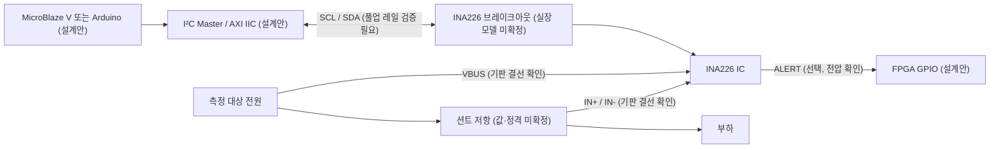

# INA226 전류·전압·전력 모니터 — 조사 후보 (정식 ID 미부여)

[devices 목차](../README.md) › [I²C 목차](README.md) › INA226 후보

> 상태: 제조사 IC 사양 조사. 특정 Arduino 호환 브레이크아웃 PCB·회로·실물·RTL/AXI/C 검증 전. 기존 32차시 및 정상 소스 변경 없음.

## 1. 목적·분류·선수관계

- 분류: I²C 디지털 전력 계측. 기존 INA219(I11)과 **다른 IC**로 중복 통합하지 않는다.
- 선수관계: 전압·전류·션트 저항 → 3.3 V I²C 전기 안전 → 레지스터·보정 → 독립 RTL I²C 또는 AXI IIC → SoC 모니터링.
- 기존 32차시: 편입 미승인. 캡스톤 후보: 모터/팬 전력 측정과 보호(설계안). SoC: MicroBlaze V + AXI IIC + 전력 상태 레지스터(설계안).

## 2. 시각화 — 논리 신호 흐름 (실제 RTL/핀맵 아님)

## 3. 구조화 — 인터페이스와 전기 제약

| 항목 | 확인된 IC 사양 / 미확인 기판 조건 |
|---|---|
| IC | TI INA226; I²C/SMBus, 16비트 측정, 전류·전압·전력 모니터 |
| IC 전원 VS | 2.7~5.5 V (TI 공식 제품 설명) |
| 측정 버스 | 0~36 V는 **측정 입력 범위**이며 FPGA GPIO/XADC 허용 전압이 아님 |
| I²C | SCL/SDA, 주소 설정 16가지(기판의 A0/A1 실장 확인 필요) |
| 선택 신호 | ALERT, FPGA 연결 시 풀업·전압·출력 특성 검증 |
| FPGA I/O | Basys3 3.3 V. 5 V I²C 풀업 직결 금지. VS가 5 V인 모듈은 기판 회로와 SDA/SCL 풀업 전원 검증 전 연결 금지 |
| XADC | 해당 없음. XADC 직접 아날로그 입력 0~1 V 제한은 별도 |
| 측정 경로 | IN+/IN-/VBUS 및 션트 저항의 실제 기판 결선·정격·공통접지 확인 전 고전압/고전류 연결 금지 |
| RTL/AXI/C | 전용 구현 없음. 16비트 레지스터 읽기·바이트 순서·부호·보정·ALERT·I²C ACK/NACK·핸드셰이크·FSM·타이밍 모두 미검증 |
| 실물 | PCB 제조사·리비전·핀맵·션트 값·풀업·레귤레이터·전압 실측 미확인 |

## 4. 근거·버전·권리

| 출처 | URL | 버전·권리 |
|---|---|---|
| Texas Instruments 공식 INA226 | https://www.ti.com/product/INA226 | 공식 제품/데이터시트 Rev. C 표기(2026-11-04 확인); 원본 자료 재배포 권한 미확인, Git SHA 해당 없음 |
| TI 공식 한국어 제품 정보 | https://www.ti.com/product/ko-kr/INA226 | 2.7~5.5 V, 0~36 V 측정, 16주소; 페이지 개정 SHA 없음 |
| Arduino Hardware Docs | https://docs.arduino.cc/hardware/ | 범용 보드 참고 경로; INA226 동일 PCB 회로 근거로 사용하지 않음 |

Keyestudio/Freenove/Seeed/국내 판매처/AliExpress/공개 GitHub의 **동일 브레이크아웃 모델·회로도·라이선스·원본 커밋은 아직 확인되지 않았다**. 원본 코드·도면·이미지 복제 없음.

## 5. 적대적 검증 및 산출물 게이트

| 게이트 | 판정 | 근거/한계 |
|---|---|---|
| ① 시각화 | 정적 PASS | Mermaid에서 SCL/SDA, IN+/IN-, VBUS, ALERT를 역할별 구분. 렌더링 미검증 |
| ② 구조화 | 정적 PASS | 목적·신호·전원·전기 제약·RTL/AXI/C·출처·미확인 항목 |
| ③ 체계화 | 정적 PASS | I²C 분류·INA219과 차이·선수관계·32차시/캡스톤/SoC·상위 링크 |
| P0 전기 | 실물 FAIL/미승인 | 3.3 V 풀업, 션트/부하·기판 전압/정격 미검증. FPGA 연결 승인 불가 |
| P1 기능 | 미검증 | 16비트·부호·보정·FSM·ACK/NACK·AXI 핸드셰이크 시험 없음 |
| 출처·저작권 | 부분 PASS | 제조사 원본 링크 및 버전, 재배포 권한 미확인 |
| HTML·링크·CI | 미검증 | 원격 게시/렌더/전체 회귀시험 별도 필요 |

**정식 신규 ID는 보류**: 실제 구매 가능한 기판의 모델·회로·풀업/전압 및 기존 목록 중복 확인 후 결정한다.
