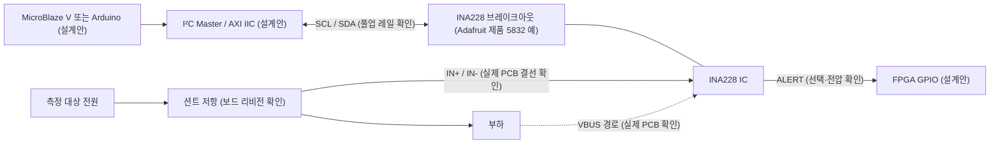

# INA228 전력·에너지 모니터 — 조사 후보 (정식 ID 미부여)

[devices 목차](../README.md) › [I²C 목차](README.md) › INA228 후보

> 상태: TI IC 사양 및 Adafruit PCB 공개 자료 조사. 실제 보드 연결·RTL/AXI/C 시험 미완료. INA219(I11)·INA226 후보와 별도 IC.

## 1. 목적·분류·선수관계
- 분류: I²C 전류·전압·전력·에너지·전하 측정.
- 선수관계: 전류/전압/션트 저항 → 3.3 V I/O와 풀업 → I²C 주소·레지스터 → AXI IIC/RTL → MicroBlaze V 전력 계측.
- 기존 32차시: 변경/편입 없음. 캡스톤: 모터 소비전력 추적(제안). SoC: MicroBlaze V + AXI IIC + 계측 소프트웨어(제안).

## 2. 시각화 (개념도, RTL 포트·PCB 핀맵 아님)

## 3. 인터페이스·전기 제약
| 항목 | 확인 사항 / 보류 사항 |
|---|---|
| IC 공급전원 | 2.7~5.5 V (TI). FPGA I/O 허용 전압과 별개 |
| 측정 공통모드 | -0.3~85 V (TI). FPGA GPIO/XADC에 직접 인가 금지 |
| 측정 | 20비트 델타시그마 ADC, 차동 션트 범위 ±163.84 mV 또는 ±40.96 mV |
| 통신 | I²C, 최대 16주소. 실제 보드 주소 점퍼 및 풀업 확인 필요 |
| 선택 출력 | ALERT: 실제 전압·풀업·출력 방식 확인 전 GPIO 직결 금지 |
| 보드 변형 | Adafruit 제품 5832: 3 V/5 V 로직 호환 주장, 15 mΩ 션트 소개. 다른 제조사·리비전에 일반화 금지 |
| FPGA 3.3 V | SCL/SDA 5 V 풀업 직접 연결 금지. 실제 회로의 레벨 변환·풀업 확인 |
| XADC | 아날로그 입력 0~1 V 제약은 별도. INA228의 85 V 측정 범위와 무관 |
| RTL/AXI/C | 미구현·미시험. 20비트 필드/부호확장·바이트 순서·보정·누산·I²C ACK/NACK·FSM·타이밍·AXI 핸드셰이크 검증 필요 |
| 실물 | PCB 리비전·션트 발열·부하 정격·접지·핀맵·풀업 전압 미확인 |

## 4. 근거·버전·권리 (2026-11-04 조사)
| 원본 | URL | 버전·라이선스 |
|---|---|---|
| TI INA228 | https://www.ti.com/product/INA228 | 데이터시트 Rev. A (2022-05-11). 제조사 원본 재배포 권한 미확인 |
| Adafruit INA228 PCB | https://github.com/adafruit/Adafruit-INA228-PCB | 공개 EagleCAD 회로/PCB; README에 CC Attribution/Share-Alike 안내, 정확한 조건은 저장소 license.txt 확인 필요. 고정 SHA 미확보 |
| Adafruit 제품 | https://www.adafruit.com/product/5832 | 제조사 제품 설명. 보드 개정/실측 미확인 |
| Arduino Hardware Docs | https://docs.arduino.cc/hardware/ | 일반 보드 참고, 이 브레이크아웃의 회로 증거로 사용하지 않음 |

Keyestudio/Freenove/Seeed/국내 판매처/AliExpress의 **동일 PCB·개정·라이선스는 미확인**. 공개 원본 회로·코드는 복제하지 않음.

## 5. P0/P1 및 산출물 게이트
| 검사 | 결과 | 근거 |
|---|---|---|
| 시각화 | 정적 PASS | Mermaid SCL/SDA, IN+/IN-, VBUS, ALERT 역할 표시. 실제 렌더 미검증 |
| 구조화 | 정적 PASS | 목적·인터페이스·전기·구현·근거·미확인 섹션 |
| 체계화 | 정적 PASS | I²C 상위 목차, INA219/INA226 구분, 32차시·캡스톤·SoC 대응 |
| P0 전기 | **미승인** | 3.3 V 풀업/기판/션트/부하 실측 전 FPGA 연결 금지 |
| P1 구현 | 미검증 | RTL·AXI·C 전용 소스·시험 없음 |
| HTML/CI/링크 | 미검증 | 원격 렌더·게시·전체 링크 검사 별도 필요 |

정식 ID 및 기계 판독 목록 등록은 보류한다.
