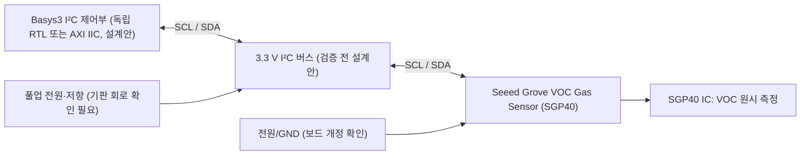

# SGP40 VOC 센서 — 조사 후보 (정식 ID 없음)

[devices](../README.md) → [I²C 목차](README.md) → [후보 상태표](../data/module-candidates.csv)

## 1. 목적·분류·근거
- 분류: 환경 / VOC(휘발성 유기화합물) / I²C. 기존 온습도 센서 SHT31·SHT40과 **측정 물리량 및 프로토콜이 다름**.
- 후보 기판: Seeed Grove VOC Gas Sensor (SGP40). 제조사 위키의 게시 갱신일: 2023-06-06. 기판 PCB revision·원본 Git SHA·라이선스: **미확인**.
- 출처: https://wiki.seeedstudio.com/grove_voc_gas_sensor_sgp40/ (Seeed 공식 위키, 모듈 전원 3.3/5 V·I²C·Grove 핀 안내·SCH/PCB 자료 링크)
- 센서 IC 원본 데이터시트 버전과 실제 판매 기판의 회로 개정은 **추가 확인 필요**. 원본 도면·코드 복제 없음, 재배포 권한 미확인.

## 2. 신호 흐름도 (설계 개념도, RTL 모듈명 아님)

※ 신호 이름은 물리 I²C SCL/SDA이며, 실제 FPGA 포트·핀 번호·RTL 인스턴스를 확정한 도면이 아니다.

## 3. 인터페이스·전기 제약
| 항목 | 근거 또는 상태 |
|---|---|
| 입력 | VCC, GND, SCL, SDA (Seeed 위키의 Grove 4선 설명; 실물 커넥터 방향 미확인) |
| 출력 | I²C를 통한 VOC 원시 측정값; 기체 농도 ppm으로 직접 단정 금지 |
| 모듈 전원 | Seeed 위키 3.3/5 V 표기. **IC 자체 전원 허용과 다름** |
| FPGA I/O | Basys3 3.3 V, 5 V 풀업 직결 금지. 보드 풀업 레일·레벨 변환 확인 전 연결 미승인 |
| XADC | 본 모듈은 I²C 방식; XADC 0~1 V 입력에 연결하지 않음 |
| 주소·측정 명령·CRC·타이밍 | IC 공식 데이터시트 대조 전 미확인; 임의 값 사용 금지 |
| 기판 변형 | Grove와 범용 브레이크아웃 동일 회로 가정 금지 |

## 4. RTL / AXI / C 대응 및 검증
| 계층 | 설계 방향 | 상태 |
|---|---|---|
| RTL | I²C 마스터 → 명령 전송 → 응답 바이트 수신 → 상태·오류 FSM | 설계안, 미구현 |
| AXI | AXI IIC를 통한 버스 전송, 별도 제어 레지스터 연계 | 설계안, 핸드셰이크 미검증 |
| C | 공식 Sensirion 드라이버 API와 원시 데이터·보정 알고리즘을 검토 후 작성 | 미구현 |
| 검증 | P0: 풀업·레벨·전원 / P1: 주소·CRC·타이밍·NACK·FSM·AXI 응답 | 모두 미승인 |

## 5. 선수관계·캡스톤·SoC 대응
- 선수: GPIO 전압 제약 → I²C 오픈드레인/풀업 → I²C 주소/명령 → 센서 원시값 처리.
- 기존 32차시: 차시 번호·내용 변경 없음. I²C 관련 차시의 **선택 확장 후보**.
- 캡스톤: 온습도(SHT31 등) + SGP40 실내 공기질 상태표시(측정값 의미 검증 후).
- SoC: 독립 RTL I²C → AXI IIC → MicroBlaze V C 드라이버. 기존 구현과의 호환성 미검증.

## 6. 게이트·미확인
- 시각화: Mermaid 신호명 정적 확인 대상; 실제 렌더링 별도 검증.
- 구조화: 목적·입출력·전기·RTL/AXI/C·출처·검증 상태 기록.
- 체계화: 후보 CSV·I²C 목차 연결, 정식 등록 전 ID 미부여.
- **미확인**: Sensirion 공식 데이터시트 판본, Grove PCB 실제 풀업/레귤레이터, 라이선스, 국내/알리 동일 기판, 실제 I²C 파형 및 CI.
