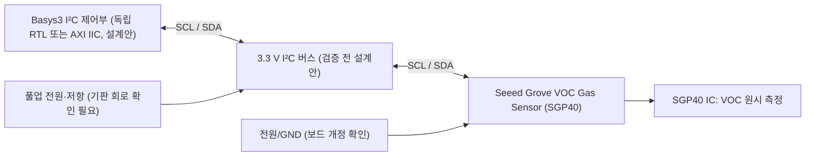

# SGP40 VOC 센서 — 조사 후보 (정식 ID 없음)

[devices](../README.md) → [I²C 목차](README.md) → [후보 상태표](../data/module-candidates.csv)

## 1. 목적·분류·근거
- 분류: 환경 / VOC(휘발성 유기화합물) / I²C. 기존 온습도 센서 SHT31·SHT40과 **측정 물리량 및 프로토콜이 다름**.
- 후보 기판: Seeed Grove VOC Gas Sensor (SGP40). 제조사 위키의 게시 갱신일: 2023-06-06. 기판 PCB revision·원본 Git SHA·라이선스: **미확인**.
- 출처: https://wiki.seeedstudio.com/grove_voc_gas_sensor_sgp40/ (Seeed 공식 위키, 모듈 전원 3.3/5 V·I²C·Grove 핀 안내·SCH/PCB 자료 링크)
- 센서 IC 공식 데이터시트: [Sensirion SGP40 Data Sheet](https://sensirion.com/resource/datasheet/sgp40) (공식 공개본; 공식 PDF version 1.2, February 2022 확인). **IC 사양과 Seeed 판매 기판 회로는 구분**하며, 실제 기판 개정은 추가 확인 필요. 원본 도면·코드 복제 없음, 재배포 권한 미확인.

## 2. 신호 흐름도 (설계 개념도, RTL 모듈명 아님)

※ 신호 이름은 물리 I²C SCL/SDA이며, 실제 FPGA 포트·핀 번호·RTL 인스턴스를 확정한 도면이 아니다.

## 3. 인터페이스·전기 제약
| 항목 | 근거 또는 상태 |
|---|---|
| 입력 | VCC, GND, SCL, SDA (Seeed 위키의 Grove 4선 설명; 실물 커넥터 방향 미확인) |
| 출력 | I²C를 통한 VOC 원시 측정값; 기체 농도 ppm으로 직접 단정 금지 |
| 모듈 전원 | Seeed 위키 3.3/5 V 표기. **IC 자체 전원 허용과 다름** |
| FPGA I/O | Basys3 3.3 V, 5 V 풀업 직결 금지. 보드 풀업 레일·레벨 변환 확인 전 연결 미승인 |
| XADC | 본 모듈은 I²C 방식; XADC 0~1 V 입력에 연결하지 않음 |
| IC 공급전압 | **1.7~3.6 V** (Sensirion 공식 제품 사양). Seeed 기판의 3.3/5 V 입력 사양과 혼동 금지 |
| IC 7비트 주소 | **0x59** (Sensirion 공식 데이터시트 4.2절). 실제 버스에서 ACK 시험 미실시 |
| IC I²C 속도 | **100/400 kHz 지원** (공식 데이터시트 4.4절); 공용 버스 속도는 가장 느린 연결 장치에 맞춤 |
| 데이터 CRC | 명령 자체는 16비트이며 뒤에 CRC를 붙이지 않음. 데이터 워드는 **16비트 + CRC 8비트** (공식 데이터시트 4.1절). CRC-8 다항식 0x31, 초기값 0xFF, 비반사, 최종 XOR 0x00. 예제 0xBE 0xEF → 0x92. 구현·실측 검증은 별도 |
| 측정 명령·타이밍 | 공식 v1.2 표 8~9: 명령 0x26 0x0F, 습도 보정 미사용 입력 `80 00 A2 66 66 93` (명령 뒤 6바이트), 응답 2바이트 원시값 + CRC 1바이트, 측정 최대 30 ms. 명령 코드 뒤 별도 CRC를 추가하지 않음. 실제 구현·파형 미검증 |
| 기판 변형 | Grove와 범용 브레이크아웃 동일 회로 가정 금지 |

### 측정 시퀀스 (데이터시트 기반 설계 개념도, 실제 RTL 상태명 아님)

실제 I²C STOP/재시작 방식 및 ACK/NACK은 데이터시트와 버스 제어기 구현에 맞춰 검증해야 하며 위 도식은 버스 파형이 아니다.

## 4. RTL / AXI / C 대응 및 검증
| 계층 | 설계 방향 | 상태 |
|---|---|---|
| RTL | I²C 마스터 → 명령 전송 → 응답 바이트 수신 → 상태·오류 FSM | 설계안, 미구현 |
| AXI | AXI IIC를 통한 버스 전송, 별도 제어 레지스터 연계 | 설계안, 핸드셰이크 미검증 |
| C | 공식 Sensirion 드라이버 API와 원시 데이터·보정 알고리즘을 검토 후 작성 | 미구현 |
| 검증 | P0: 풀업·레벨·전원 / P1: 주소·CRC·타이밍·NACK·FSM·AXI 응답 | 모두 미승인 |

## 5. 선수관계·캡스톤·SoC 대응
- 선수: GPIO 전압 제약 → I²C 오픈드레인/풀업 → I²C 주소/명령 → 센서 원시값 처리.
- 기존 32차시: 차시 번호·내용 변경 없음. I²C 관련 차시의 **선택 확장 후보**.
- 캡스톤: 온습도(SHT31 등) + SGP40 실내 공기질 상태표시(측정값 의미 검증 후).
- SoC: 독립 RTL I²C → AXI IIC → MicroBlaze V C 드라이버. 기존 구현과의 호환성 미검증.

## 6. 출처 판본 및 게이트·미확인
- [Sensirion 공식 SGP40 PDF v1.2 (2022-02)](https://sensirion.com/media/documents/296373BB/6203C5DF/Sensirion_Gas_Sensors_Datasheet_SGP40.pdf), §4.6~4.7 및 표 7~10. 원본 파일 재배포하지 않음; 문서 저작권/재배포 라이선스 미확인.
- 버전 1.0(2020-07)과 v1.2(2022-02)의 자체 시험 명령 명칭·시간 차이를 혼용하지 않으며 본 문서는 v1.2를 기준으로 함.

- 시각화: Mermaid 신호명 정적 확인 대상; 실제 렌더링 별도 검증.
- 구조화: 목적·입출력·전기·RTL/AXI/C·출처·검증 상태 기록.
- 체계화: 후보 CSV·I²C 목차 연결, 정식 등록 전 ID 미부여.
- **미확인**: Grove PCB 실제 풀업/레귤레이터, 라이선스, 국내/알리 동일 기판, 실제 I²C 파형 및 CI.
