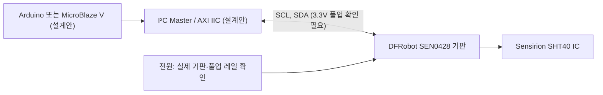

# SHT40 온습도 센서 — 조사 후보 (정식 ID 미부여)

> 상태: 조사·설계안. Basys3 실물 연결, RTL/AXI/C 드라이버, 합성 및 타이밍 미검증. 기존 32차시 변경 없음.

## 1. 목적과 분류
- I²C 디지털 온도·습도 입력 후보. 기존 AHT20(I13), SHT31과 **별개 IC/명령 체계**이며 드라이버 호환을 가정하지 않는다.
- 선수관계: 3.3V 전기 안전 → 오픈드레인 I²C → 측정 명령/응답/CRC → AXI IIC 또는 독립 RTL → SoC 레지스터/응용.
- 대응: Arduino Wire 기반 실습(설계안) ↔ Basys3 I²C 컨트롤러(설계안) ↔ MicroBlaze V + AXI IIC(설계안). 기존 32차시 및 캡스톤에는 아직 편입하지 않음.

## 2. 시각화 — 개념 연결 (실제 RTL 신호명이 아님)

※ 도식은 논리적 흐름이며, 실측 배선도·검증된 RTL 포트맵이 아니다.

## 3. 구조화 — 하드웨어 인터페이스

| 항목 | 확인 또는 제한 |
|---|---|
| IC | Sensirion SHT40, 디지털 I²C, IC 공급 1.08~3.6V(제조사) |
| 기판 변형 | DFRobot Fermion SEN0428, 기판 공급 3.3~5V(판매사); IC 직접 5V 공급 가능을 뜻하지 않음 |
| 기판 핀 표기 | VCC, GND, SCL, SDA (DFRobot 위키). 실제 보드 방향·배선은 실물 확인 |
| I²C 주소 | SHT40 변형에 따라 0x44 또는 0x45 가능; 구매한 실장품 주소 확인 전 고정하지 않음 |
| FPGA I/O | Basys3 3.3V I/O. SDA/SCL 풀업이 5V이면 직결 금지. 기판 회로·풀업 레일 미확인 |
| XADC | 해당 없음(디지털 I²C). XADC 아날로그 입력은 0~1V 제한 별도 적용 |
| 데이터 처리 | 온도·습도 각 16비트와 CRC 바이트 처리 필요(설계 검증 전) |
| RTL·AXI·C | 구현·검증 없음. 핸드셰이크, FSM, 타이밍, CRC, NACK/재시도 시험 미실시 |
| 하드웨어 시험 | 전원·풀업·핀 방향·주소·파형 미측정, 직접 연결 미승인 |

## 4. 원본·버전·저작권

| 출처 | URL | 버전/권리 |
|---|---|---|
| Sensirion 공식 제품 지원 | https://d.sensirion.com/product-support/sht4x-humidity-and-temperature-sensor | 제조사 페이지, 2026-11-03 열람; 고정 SHA 없음, 재배포 권한 미확인 |
| Sensirion 제품 데이터시트 | https://sensirion.com/de/produkte/katalog/SHT40-AD1F | 공식 페이지의 2025-04 데이터시트 링크; 파일 해시 미확인 |
| DFRobot SEN0428 | https://wiki.dfrobot.com/sen0428/ | 핀 표기·기판 전원; 보드 리비전/풀업 회로 실물 대조 미완료 |
| DFRobot 제품 | https://www.dfrobot.com/product-2437.html | SKU SEN0428; 판매 페이지, 버전/라이선스 미확인 |
| Linux 커널 드라이버 참고 | https://kernel.googlesource.com/pub/scm/linux/kernel/git/next/linux-next/+/5358248961ae23f7253d010ddfde1cfd2556ce22/Documentation/hwmon/sht4x.rst | 고정 Git 커밋 5358248961ae23f7253d010ddfde1cfd2556ce22, SPDX GPL-2.0. 원본 코드 복제 없음 |

Keyestudio·Freenove·Seeed·국내 판매처·AliExpress의 동일 기판 실장 회로 및 라이선스는 이번 조사에서 확인되지 않아 **미확인**.

## 5. 적대적 검증 게이트 (2026-11-03)

| 게이트 | 결과 | 근거·미해결 |
|---|---|---|
| 시각화 | PASS(문서 정적 구조) | Mermaid 신호 SCL/SDA와 본문 명칭 일치. 렌더링 자동시험 미실시 |
| 구조화 | PASS(문서 정적 구조) | 목적/핀/전원/RTL·AXI·C/근거/미확인 포함 |
| 체계화 | PASS(문서 정적 구조) | I²C 분류·선수관계·32차시/SoC 대응 및 상위 링크 필요 |
| P0 실물 전기 안전 | 미검증 | 5V 풀업 직결 금지, 회로·실측 없음 |
| P1 RTL·드라이버 | 미검증 | 구현·테스트 없음 |
| 출처·권리 | 부분 확인 | URL·일부 고정 커밋 기록, 기판 회로·라이선스 미확인 |

정식 신규 모듈 등록은 기판 전기 조건 및 목록 중복 재검토 이후 결정한다.
