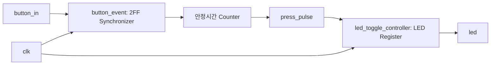

# RTL01 — 버튼 입력·디바운스·LED 토글

[RTL 홈](../README.md) · [Arduino 01](../../arduino/examples/01_led_button/README.md) · [Arduino 02](../../arduino/examples/02_button_toggle/README.md)

## 회로 구조

## 설계 내용
- `button_event`: 외부 버튼을 2단 FF로 동기화하고, 안정 상태가 연속 `TICKS` 클럭 지속될 때만 갱신한다.
- `press_pulse`: 누름 전이에서 **1클럭** 동안만 1. 버튼을 계속 누르고 있어도 여러 번 발생하지 않는다.
- `led_toggle_controller`: `press_pulse`가 1인 클럭 엣지에서 LED FF를 반전한다.
- 100 MHz 기준 클럭 10 ns, 20 ms 디바운스는 2,000,000 클럭. `count` 비트 폭은 21비트이다.
- Reset은 active-high **동기 리셋**이다. 시뮬레이션 예제의 `CLK_HZ=1000`은 검증 속도를 높이기 위한 축소 설정이다.

## 파일
| 파일 | 역할 |
|---|---|
| [src/button_event.v](src/button_event.v) | 동기화·안정 필터 |
| [src/led_toggle_controller.v](src/led_toggle_controller.v) | 버튼 누름 이벤트 저장 |
| [src/basys3_button_led_top.v](src/basys3_button_led_top.v) | Top 핀/모듈 연결 |
| [tb/tb_button_led.v](tb/tb_button_led.v) | 이벤트/상태 검증 |

## 검증
- 파일 작성: 완료
- RTL 시뮬레이션: 미실행
- Synthesis/Timing: 미실행
- Basys3 실물: 미실행
- XDC 핀 연결: 미확정. Basys3 사용자 버튼은 눌림이 High이므로 Top에서 `ACTIVE_LOW=0`으로 설정했다. Testbench는 pull-up 방식 버튼을 모델링해 `ACTIVE_LOW=1`을 사용한다.
- Icarus Verilog 예시: `iverilog -g2012 -s tb_button_led -o sim rtl/rtl01_button_led/src/button_event.v rtl/rtl01_button_led/src/led_toggle_controller.v rtl/rtl01_button_led/tb/tb_button_led.v && vvp sim`

## 이 폴더의 목록

<!-- index:begin -->
<!-- 이 목록은 devices/tools/gen_index.py 가 만든다. 직접 고치지 말 것. -->

### 하위 폴더

| 폴더 | 내용 |
|---|---|
| [src/](src/README.md) | src |
| [tb/](tb/README.md) | 호스트 테스트와 레지스터/장치 모델(mock) |

<!-- index:end -->
