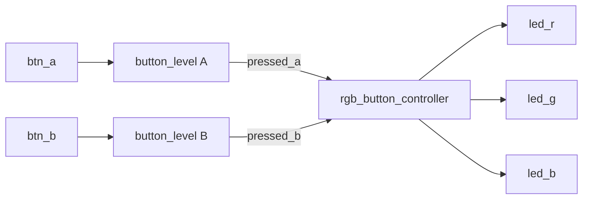

# RTL02 — 버튼 2개로 RGB LED 제어

[RTL 전체 목차](../README.md) · [Arduino 03차시](../../arduino/examples/03_rgb_buttons/README.md)

## 회로 구조


## 동작 기준
| pressed_a | pressed_b | led_r | led_g | led_b | 표시 |
|---:|---:|---:|---:|---:|---|
| 0 | 0 | 0 | 0 | 0 | OFF |
| 1 | 0 | 1 | 0 | 0 | RED |
| 0 | 1 | 0 | 1 | 0 | GREEN |
| 1 | 1 | 0 | 0 | 1 | BLUE |

- `button_level`은 2단 FF 동기화 + Counter 필터의 **순차회로**. 안정된 입력만 `pressed` 레지스터에 저장한다.
- `rgb_button_controller`는 현재 버튼 레벨에 따라 색상을 결정하는 **조합회로**. 추가 클럭 지연이나 상태 레지스터가 없다.
- 100 MHz 기준 1클럭 10 ns, 20 ms 안정시간은 2,000,000클럭이며 카운터는 21비트.
- Top은 입력/출력, wire, 모듈 인스턴스 연결만 한다.
- `rst`는 active-high **동기 Reset**. 실제 Basys3 버튼 입력은 누르면 High로 동작한다.
- Basys3 내장 RGB LED 1개의 R/G/B 제어를 기준으로 하며, 정확한 XDC 핀은 실제 배치에 따라 확인한다.

## 파일
| 파일 | 역할 |
|---|---|
| [src/button_level.v](src/button_level.v) | 동기화와 디바운스 |
| [src/rgb_button_controller.v](src/rgb_button_controller.v) | RGB 조합논리 |
| [src/basys3_rgb_buttons_top.v](src/basys3_rgb_buttons_top.v) | Shell/Wrapper |
| [tb/tb_rgb_buttons.v](tb/tb_rgb_buttons.v) | 입력 시나리오 검사 |

## 검증
RTL 파일과 테스트벤치는 작성했지만, 시뮬레이션·합성·Timing·보드 실물 검증은 수행하지 않았다. 시뮬레이션에서는 빠른 검증을 위해 카운터를 축소한다.

```bash
iverilog -g2012 -s tb_rgb_buttons -o sim \
  rtl/rtl02_rgb_buttons/src/button_level.v \
  rtl/rtl02_rgb_buttons/src/rgb_button_controller.v \
  rtl/rtl02_rgb_buttons/tb/tb_rgb_buttons.v
vvp sim
```

## 이 폴더의 목록

<!-- index:begin -->
<!-- 이 목록은 devices/tools/gen_index.py 가 만든다. 직접 고치지 말 것. -->

### 하위 폴더

| 폴더 | 내용 |
|---|---|
| [src/](src/README.md) | src |
| [tb/](tb/README.md) | 호스트 테스트와 레지스터/장치 모델(mock) |

<!-- index:end -->
