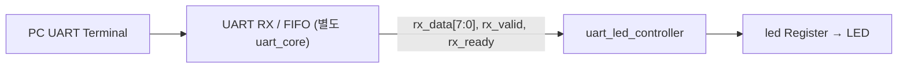

# RTL03 — UART 바이트 명령으로 LED 제어

[RTL 목차](../README.md) · [Arduino 04차시](../../arduino/examples/04_serial_led/README.md) · [UART 주변장치 자료](../../devices/uart/README.md)

## 동작 구조



기존 저장소에서 재사용할 실제 `uart_core.v` 파일을 확인하지 못했으므로 **물리 UART 수신기와 FIFO를 새로 중복 작성하지 않았다.** 현재 실습의 입력은 UART에서 복원된 8비트 Byte Stream이다. `uart_led_stream_top`은 해당 스트림을 Controller에 연결하는 재사용 가능한 Shell이며 보드 핀 Top은 아니다.

## 명령 규약과 Clock 동작

| 수신 데이터 | ASCII | LED 동작 |
|---|---|---|
| `8'h31` | '1' | ON |
| `8'h30` | '0' | OFF |
| 그 외 | 'X' 등 | 유지 |

- `rx_ready`는 1로 고정되어 매 클럭 최대 1바이트를 수신할 준비를 한다.
- **posedge clk** 시점에 `rx_valid && rx_ready`가 참이면 `rx_data`를 해석하고 `led` Flip-Flop에 다음 값을 저장한다.
- `rx_valid=0`이면 `rx_data` 값이 변해도 LED 상태는 유지된다.
- `rst`는 active-high 동기 리셋이다.
- 100MHz 기준 1Clock은 10ns. UART 115200bps의 한 비트 시간은 약 8.68µs이며, 한 프레임(8N1)은 약 86.8µs. UART 비트 타이밍 구현은 이 Controller가 아니라 별도 RX 코어 담당이다.

## 파일

| 파일 | 구분 |
|---|---|
| [src/uart_led_controller.v](src/uart_led_controller.v) | 기능 RTL |
| [src/uart_led_stream_top.v](src/uart_led_stream_top.v) | Byte Stream 연결용 Shell |
| [tb/tb_uart_led_controller.v](tb/tb_uart_led_controller.v) | 자체검사 Testbench |

## Simulation

저장소 루트에서 실행:

```bash
iverilog -g2012 -s tb_uart_led_controller -o /tmp/rtl03_sim \
  rtl/rtl03_uart_led/src/uart_led_controller.v \
  rtl/rtl03_uart_led/tb/tb_uart_led_controller.v
vvp /tmp/rtl03_sim
```

예상 결과: `PASS uart_led_controller` (실행 결과 아님).

## 검증 단계

| 항목 | 상태 |
|---|---|
| RTL·Testbench 작성 | 완료 |
| iverilog Simulation | 미실행 |
| Vivado Synthesis/Timing | 미실행 |
| 기존 uart_core와 통합 | 코어 소스 확인 전 |
| Basys3 UART RX 실물 확인 | 미실행 |

**다음 통합 단계:** 기존 `uart_core`의 `rx_out_data/rx_out_valid/rx_out_ready` 포트가 실제로 존재하는지 확인한 뒤 동일 신호에 연결하고, Basys3 UART RX 핀과 XDC를 확정한다. 인터페이스가 다르면 별도 검토 후 연결 규약을 정한다.

## 이 폴더의 목록

<!-- index:begin -->
<!-- 이 목록은 devices/tools/gen_index.py 가 만든다. 직접 고치지 말 것. -->

### 하위 폴더

| 폴더 | 내용 |
|---|---|
| [src/](src/README.md) | src |
| [tb/](tb/README.md) | 호스트 테스트와 레지스터/장치 모델(mock) |

<!-- index:end -->
