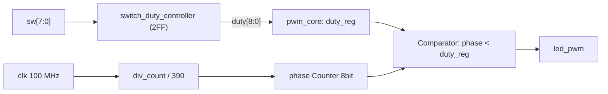

# RTL04 — PWM Counter·Comparator·Duty Register

[RTL 홈](../README.md) · [Arduino 06차시](../../arduino/examples/06_pot_pwm/README.md) · [Arduino 07차시](../../arduino/examples/07_cds_auto_light/README.md)

## 회로 구조


## 코드와 하드웨어
- `switch_duty_controller`: 보드 스위치 비동기 입력의 2FF 동기화. `sw=255`일 때 `duty=256`으로 매핑해 100%를 표현한다.
- `pwm_core`: `div_count`가 390클럭마다 `phase`를 1 증가시킨다. `phase`는 8비트 순환 Counter(0~255).
- `duty_reg`는 `phase=255` 종료 시에만 갱신해, 주기 중 듀티 변경으로 인한 파형 글리치를 줄인다.
- `pwm_out`은 `{1'b0,phase} < duty_reg` Comparator 결과. Clock 저장 값이 아닌 조합 출력이다.
- 100 MHz일 때 PWM 한 주기: 390 × 256 × 10ns → 998.4µs, 약 1001.6Hz.
- Duty는 9비트(0~256)라 0%와 100%를 모두 표현한다. 50%는 128/256.

## 예시 파형 설명
- Duty 0: 비교 결과 항상 Low.
- Duty 128: phase 0~127에서는 High, 128~255에서는 Low.
- Duty 256: phase 0~255에서 항상 High.
- 스위치 상태는 다음 PWM 주기 경계에서 반영된다.

## 파일
| 파일 | 역할 |
|---|---|
| [src/pwm_core.v](src/pwm_core.v) | Prescaler/Counter/Duty Register/Comparator |
| [src/switch_duty_controller.v](src/switch_duty_controller.v) | 스위치 동기화 및 Duty 매핑 |
| [src/basys3_pwm_led_top.v](src/basys3_pwm_led_top.v) | 연결만 하는 Top |
| [tb/tb_pwm_core.v](tb/tb_pwm_core.v) | 0%, 50%, 100% High 비율 자체검사 |

## 시뮬레이션
저장소 루트에서 실행:

```bash
iverilog -g2012 -s tb_pwm_core -o /tmp/rtl04_sim \
  rtl/rtl04_pwm_led/src/pwm_core.v \
  rtl/rtl04_pwm_led/tb/tb_pwm_core.v
vvp /tmp/rtl04_sim
```

예상 문구: `PASS pwm_core 0/50/100 percent` (실행 결과 아님).

## 구현 경계
- 이번 실습은 Basys3 **스위치 → PWM → 보드 LED**만 수행한다. ADC 또는 CdS 입력을 직접 연결하지 않는다.
- 다음 단계에 XADC IP 출력(샘플 레지스터)을 받아 듀티로 변환하는 Controller를 별도로 연결한다. Basys3의 XADC 입력 범위/핀은 실물 회로도 및 설정 확인이 필요하다.
- Top의 Reset은 active-high 동기 리셋이다. 실제 XDC와 핀 전기적 규칙은 아직 확인 전.

## 검증 상태
| 단계 | 상태 |
|---|---|
| RTL·Testbench 작성 | 완료 |
| Icarus RTL 시뮬레이션 | 미실행 |
| Vivado 합성·타이밍 | 미실행 |
| Basys3 보드 테스트 | 미실행 |

## 이 폴더의 목록

<!-- index:begin -->
<!-- 이 목록은 devices/tools/gen_index.py 가 만든다. 직접 고치지 말 것. -->

### 하위 폴더

| 폴더 | 내용 |
|---|---|
| [src/](src/README.md) | src |
| [tb/](tb/README.md) | 호스트 테스트와 레지스터/장치 모델(mock) |

<!-- index:end -->
