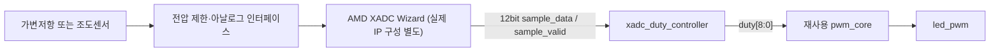

# RTL05 — XADC 샘플 → PWM 듀티 Controller

[RTL 목차](../README.md) · [RTL04 PWM](../rtl04_pwm_led/README.md) · [Arduino 가변저항 ADC](../../arduino/examples/05_pot_adc/README.md)

## 1. 회로 구조



## 2. 코드와 신호

| 신호 | Bit | 의미 |
|---|---:|---|
| `sample_data` | 12 | 유효한 ADC 샘플 값 (0~4095) |
| `sample_valid` | 1 | ADC 샘플 유효 표시. 높은 클럭 에지에서 저장 |
| `duty` | 9 | PWM 듀티 0~256 |
| `led_pwm` | 1 | PWM 디지털 파형 |

- **순차논리:** `sample_valid`가 1인 `posedge clk`에서 `duty` 레지스터를 갱신한다. 그 외 클럭에서는 이전 값을 유지한다.
- **변환:** `sample_data[11:4]`는 0~255이며, 입력이 `12'hFFF`일 때만 `duty`를 256으로 만들어 100% 출력을 지원한다. 값 4094에서는 255/256이다.
- **재사용:** RTL04의 `pwm_core`를 코드 복사 없이 그대로 연결한다. `pwm_core` 내부 `duty_reg`는 다음 PWM 주기 경계에서 갱신된다.
- **Top 역할:** `xadc_pwm_stream_top`은 연결 전용이다. 보드 아날로그 핀이나 특정 XADC Wizard 포트는 포함하지 않는다.

## 3. 실제 회로 연결 전 필수 확인
- Basys3 외부 XADC 아날로그 입력을 **5V에 직접 연결하지 않는다**. 실제 커넥터·보드 회로·XADC 설정의 허용 전압 범위를 확인한다.
- 이 실습은 XADC Wizard에서 12비트 `sample_data`와 `sample_valid`가 정리된 **동기 인터페이스**를 공급한다고 가정한다. 실제 XADC IP의 `do_out[15:0]`/`drdy_out` 또는 AXI4-Stream 등 정확한 인터페이스를 확인한 뒤 **어댑터**를 작성해야 한다.
- XADC가 다른 클럭 도메인에서 동작하면 단순한 2FF 동기화만으로 12비트 데이터 버스를 전달할 수 없다. 핸드셰이크 또는 비동기 FIFO 등 CDC 회로를 검토한다.
- PWM 출력 LED는 디지털 GPIO에 연결한다. XADC 측정 전압 및 디지털 출력 전압을 혼동하지 않는다.

## 4. 파일과 실행

| 파일 | 역할 |
|---|---|
| [src/xadc_duty_controller.v](src/xadc_duty_controller.v) | ADC 코드 → 듀티 레지스터 |
| [src/xadc_pwm_stream_top.v](src/xadc_pwm_stream_top.v) | Controller와 기존 PWM 연결 |
| [tb/tb_xadc_duty_controller.v](tb/tb_xadc_duty_controller.v) | 0, 중간값, 최대값, valid, reset 검증 |
| [../rtl04_pwm_led/src/pwm_core.v](../rtl04_pwm_led/src/pwm_core.v) | 기존 PWM 공통 모듈 (수정 없음) |

저장소 루트에서 시뮬레이션:

```bash
iverilog -g2012 -s tb_xadc_duty_controller -o /tmp/rtl05_sim \
  rtl/rtl05_xadc_pwm/src/xadc_duty_controller.v \
  rtl/rtl05_xadc_pwm/tb/tb_xadc_duty_controller.v
vvp /tmp/rtl05_sim
```

예상: `PASS xadc_duty_controller` (실행 결과 아님).

통합 RTL 문법 검사에 추가할 파일: `rtl/rtl05_xadc_pwm/src/xadc_pwm_stream_top.v` 및 `rtl/rtl04_pwm_led/src/pwm_core.v`.

## 5. 검증 상태
- Controller·연결 모듈·테스트벤치 작성 완료
- Icarus 시뮬레이션: 미실행
- XADC Wizard 실 IP 인스턴스 연결: 미완료
- Vivado 합성·Timing: 미실행
- Basys3 배선·실물 시험: 미실행
