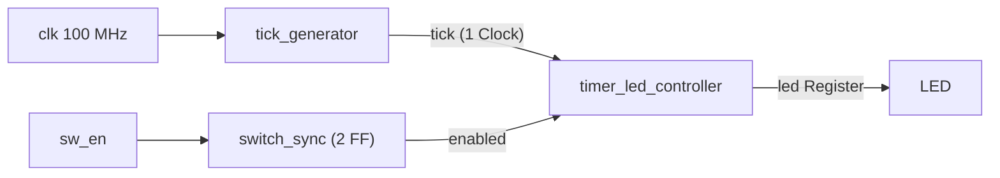

# RTL06 — Timer Tick 기반 LED 점멸

[RTL 전체 목차](../README.md) · [Arduino 09차시](../../arduino/examples/09_millis_timer/README.md)

## 회로 구조



- `tick_generator`: Counter가 50,000,000클럭을 세면 **1클럭 폭의 tick**을 만든다. 별도 클럭을 생성하지 않고 Clock Enable 방식으로 동작한다.
- `timer_led_controller`: `tick=1`일 때 LED 저장값을 반전한다. `enabled=0`이면 LED를 끈다.
- `switch_sync`: 보드 스위치의 비동기 입력을 2단 FF 동기화한다. 스위치 바운스 제거는 별도 과제이며 이번에는 생략한다.
- `basys3_timer_led_top`: Board pin, wire, module 연결만 수행.

## 클럭별 동작과 시간

100 MHz 클럭 → 1클럭 10ns. 50,000,000클럭마다 tick 발생 → **0.5초마다 LED 반전, 전체 점멸 주기 1초(1 Hz)**.

`tick_generator`의 Counter는 26비트이며 `count`가 마지막 값에 도달하는 클럭에서 `tick`이 등록된다. `timer_led_controller`는 같은 클럭의 이전 `tick`을 읽으므로 LED 반전은 그 다음 상승 에지에 일어난다. 점멸의 간격은 0.5초로 유지된다.

## 파일 및 검증

| 파일 | 역할 |
|---|---|
| [src/tick_generator.v](src/tick_generator.v) | Counter와 1클럭 Tick |
| [src/timer_led_controller.v](src/timer_led_controller.v) | LED 상태 Register |
| [src/switch_sync.v](src/switch_sync.v) | 2FF 스위치 동기화 |
| [src/basys3_timer_led_top.v](src/basys3_timer_led_top.v) | 연결 전용 Top |
| [tb/tb_timer_led.v](tb/tb_timer_led.v) | Tick/LED 동작 테스트벤치 |

저장소 루트에서:

```bash
iverilog -g2012 -s tb_timer_led -o /tmp/rtl06_sim \
  rtl/rtl06_timer_led/src/tick_generator.v \
  rtl/rtl06_timer_led/src/timer_led_controller.v \
  rtl/rtl06_timer_led/tb/tb_timer_led.v
vvp /tmp/rtl06_sim
```

예상 출력: `PASS timer_led tick/enable` (아직 실행 결과는 아님).

## 검증 상태
- RTL 및 Testbench: 작성 완료
- 실제 RTL 시뮬레이션: 미실행
- Vivado 합성·타이밍: 미실행
- XDC 및 Basys3 보드 동작: 미실행

## 이 폴더의 목록

<!-- index:begin -->
<!-- 이 목록은 devices/tools/gen_index.py 가 만든다. 직접 고치지 말 것. -->

### 하위 폴더

| 폴더 | 내용 |
|---|---|
| [src/](src/README.md) | src |
| [tb/](tb/README.md) | 호스트 테스트와 레지스터/장치 모델(mock) |

<!-- index:end -->
