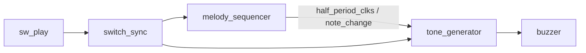

# RTL07 — 부저 주파수 발생기 + 3음 멜로디

[RTL 목차](../README.md) · [Arduino 10차시](../../arduino/examples/10_button_buzzer/README.md) · [RTL06 스위치 동기화](../rtl06_timer_led/README.md)

## 회로 구조



- `melody_sequencer`: 0.25초 간격으로 A4(440Hz), C5(523Hz), E5(659Hz)를 순환하는 상태·시간 카운터. `note_change`는 1클럭 펄스.
- `tone_generator`: 입력받은 반주기 클럭 수만큼 세어 출력을 반전하는 순차회로. 음 전환에서 카운터와 출력을 초기화한다.
- `switch_sync`: RTL06의 2FF 모듈을 그대로 재사용한다. Top은 기능 논리 없이 모듈 연결만 수행.
- 100MHz일 때 반주기 클럭 수: 440Hz 약 113636, 523Hz 약 95602, 659Hz 약 75872. 정수 분주로 주파수 오차가 발생한다.
- 보드에서는 3.3V FPGA 핀으로 고전류 부저를 직접 구동하지 않는다. 수동 피에조 소자의 정격을 확인하고 필요하면 트랜지스터 드라이버 사용.
- 외부 스위치는 비동기 입력이므로 2단 FF 동기화 후 사용한다. 기계식 바운스는 완전히 제거하지 않는 구성이다.

## 파일

| 파일 | 용도 |
|---|---|
| [src/melody_sequencer.v](src/melody_sequencer.v) | 음계 순서와 지속시간 |
| [src/tone_generator.v](src/tone_generator.v) | 출력 주파수 회로 |
| [src/basys3_buzzer_top.v](src/basys3_buzzer_top.v) | 순수 연결 Top |
| [tb/tb_buzzer_melody.v](tb/tb_buzzer_melody.v) | 순환·음 출력·정지 검증 |
| [기존 switch_sync.v](../rtl06_timer_led/src/switch_sync.v) | RTL06 재사용 |

## Simulation

저장소 루트에서:

```bash
iverilog -g2012 -s tb_buzzer_melody -o /tmp/rtl07_sim \
  rtl/rtl07_buzzer_melody/src/melody_sequencer.v \
  rtl/rtl07_buzzer_melody/src/tone_generator.v \
  rtl/rtl07_buzzer_melody/tb/tb_buzzer_melody.v
vvp /tmp/rtl07_sim
```

예상 메시지: `PASS buzzer melody` (실행 결과 아님).

## 검증 현황

| 단계 | 상태 |
|---|---|
| RTL 및 테스트벤치 작성 | 완료 |
| Icarus 시뮬레이션 | 미실행 |
| Vivado Synthesis/Timing | 미실행 |
| Basys3 보드 테스트 | 미실행 |

## 이 폴더의 목록

<!-- index:begin -->
<!-- 이 목록은 devices/tools/gen_index.py 가 만든다. 직접 고치지 말 것. -->

### 하위 폴더

| 폴더 | 내용 |
|---|---|
| [src/](src/README.md) | src |
| [tb/](tb/README.md) | 호스트 테스트와 레지스터/장치 모델(mock) |

<!-- index:end -->
